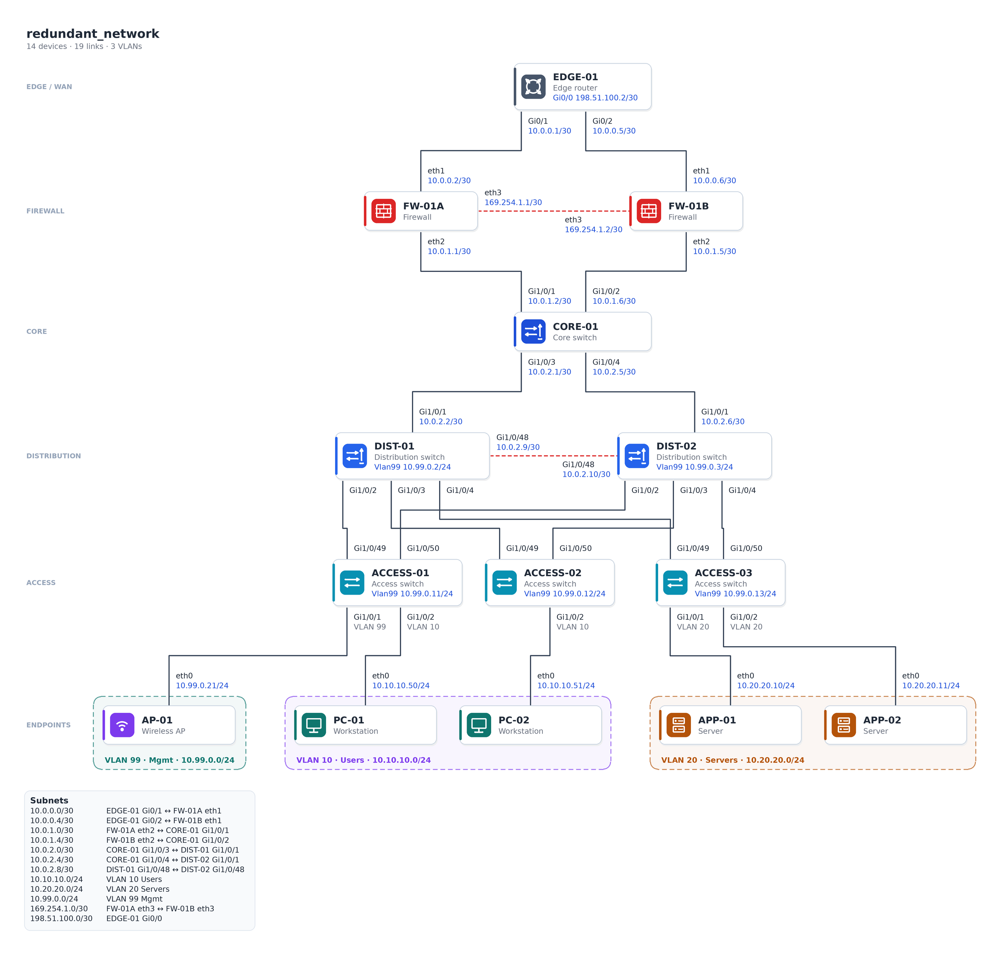

# mynetworkmaps

Tools for turning a simple device list into an accurate, clean network diagram.

The first tool is **netdiag**, a small Python command that reads a CSV of devices, addresses and links,
checks the addressing, and draws the network in fixed role rows with nothing overlapping. It writes:

- `name.drawio`: an editable draw.io / diagrams.net file. Devices are real shapes, links are real
  connectors attached to both devices, and port labels ride on their links.
- `name.svg` and `name.png`: images for documents and slides.
- `name.html`: a self-contained page where you can drag devices around in any browser.
- `name.overlaps.json`: the overlap counts for that drawing (see "How clean is it?").

Python does all of the exact work. There are no AI calls, no links are ever guessed, and input values are
never changed. Validation reports problems; it does not fix them.



## Install (Windows, PowerShell)

You need Python 3.9 or newer from python.org or the Microsoft Store.

```powershell
git clone https://github.com/cwarloe/mynetworkmaps.git
cd mynetworkmaps
py -m venv .venv
.\.venv\Scripts\Activate.ps1
pip install -e .
```

If PowerShell blocks the activate script, run `Set-ExecutionPolicy -Scope CurrentUser RemoteSigned` once.
The only runtime dependency is Pillow, which installs from a wheel with no compilers or system libraries.

## Run it

```powershell
netdiag samples\ten_device_tree.csv -o out
netdiag samples\redundant_network.csv -o out
start out\redundant_network.png
start out\redundant_network.html
```

Open the `.drawio` file in the diagrams.net desktop app or at https://app.diagrams.net (File, Open from,
Device). Use `--check-only` to validate without drawing, `--title "My office"` to set the title, and
`--scale 3` for a larger PNG.

## The CSV

One row per interface (or one row per device if it has a single address). Only `name`, `role` and
`address` are required columns; every other column may be left out or blank.

| column | meaning |
| --- | --- |
| `name` | device name, for example `CORE-01`. Rows with the same name are the same device. |
| `role` | `edge` (or `router`, `wan`), `firewall`, `core`, `distribution`, `access` (or `switch`), `ap`, `pc`, `server`, `printer`, `phone`, or `vlan` (see below) |
| `address` | IP in CIDR form, for example `10.0.0.1/30`. May be blank for a Layer 2 port. |
| `interface` | interface name for this row, for example `Gi1/0/1` or `Vlan99` |
| `vlan` | VLAN id this address or port belongs to |
| `connected_to` | name of the device on the other end of this interface's link |
| `local_port` | this device's port for the link (defaults to `interface`) |
| `remote_port` | the other device's port |
| `notes` | free text; shows as a tooltip in draw.io |

Define each VLAN once with a `vlan` row: `Users,vlan,10.10.10.0/24,,10`. That gives VLAN 10 the name
"Users" and the subnet used for checking every address in VLAN 10.

A link only needs to be written once, from either end. If both ends write it, the two rows are merged.
Rows with an address but no `connected_to` (management SVIs, gateways, WAN addresses) are shown inside the
device box.

If the file has no links at all, netdiag draws an inventory instead, grouped by VLAN or subnet
(`samples\inventory_only.csv`).

## What validation checks

| code | problem |
| --- | --- |
| `invalid-cidr` | not a valid address, no `/prefix`, or an IPv4-mapped IPv6 address (`::ffff:...`) |
| `outside-subnet` | address not in its VLAN's subnet, or link ends in different subnets |
| `host-is-network`, `host-is-broadcast` | a network or broadcast address used as a host |
| `link-prefix-mismatch` | link ends share an address range but disagree on prefix length |
| `duplicate-ip` | the same IP on two different interfaces (IPv6 and IPv4 link-local are unique per VLAN or link, not across the file) |
| `dangling-link` | `connected_to` names a device that is not in the file |
| `port-reused` | one port is used by two different links |
| `ambiguous-link` | a row could describe more than one existing cable; fill in the ports |
| `undefined-vlan` | a VLAN id with no `vlan` definition row |
| `extra-fields` | more fields than the header (quote values that contain commas) |
| `invalid-vlan`, `duplicate-vlan`, `duplicate-column`, `unknown-role`, `role-conflict`, `missing-column` | what they say |

Any error stops the run with exit code 1 and nothing is drawn. The files in `samples\bad\` each trigger
one of these on purpose. Warnings (`subnet-anycast`, `self-link`, `link-subnet-unchecked`, `no-address`,
`unknown-column`) are reported, but the diagram is still drawn.

## How the layout works

1. Devices go into fixed rows by role: edge, firewall, core, distribution, access, endpoints.
2. Order inside each row is chosen to reduce line crossings (barycenter sweeps, best result kept).
   Linked peers in the same row, such as an HA firewall pair or a distribution cross-link, are kept side by
   side and joined by a short dashed red line.
3. Every label is measured with the bundled DejaVu Sans font. Device widths and gaps are computed from
   those measurements so each port label has its own slot beside its own line.
4. Links are orthogonal: down from a port, across on their own horizontal track in the gap between rows,
   and down into the port on the other device. Links that skip a row pass through a reserved gap in it.
5. Endpoints are grouped into VLAN boxes, and a subnet table is added at the bottom.

The same input always gives the same drawing.

## How clean is it?

`netdiag` runs a geometry check on its own output and writes the counts next to the drawing. It counts
label on label, label on device, line through device, line through another link's label, line through its
own label, device on device, and two lines drawn on top of each other. It also reports line crossings for
information, since crossings can be unavoidable (three access switches each dual-homed to two distribution
switches need at least three).

Current results on the samples:

| sample | tool | label/label | label/device | line/device | line/other label | line/own label | crossings |
| --- | --- | --- | --- | --- | --- | --- | --- |
| ten_device_tree | netdiag | 0 | 0 | 0 | 0 | 0 | 0 |
| ten_device_tree | Graphviz dot, splines | 0 | 0 | 0 | 0 | 6 | 0 |
| ten_device_tree | Graphviz dot, ortho | 0 | 0 | 0 | 0 | 0 | 0 |
| redundant_network | netdiag | 0 | 0 | 0 | 0 | 0 | 3 |
| redundant_network | Graphviz dot, splines | 4 | 4 | 0 | 3 | 20 | 3 |
| redundant_network | Graphviz dot, ortho | 4 | 6 | 0 | 1 | 0 | 3 |

Plain Graphviz is already clean on the simple tree with `splines=ortho`, so for small tree-shaped networks
it is a fair alternative. It is the redundant sample (HA pair, cross-link, dual-homed access) where its
port labels start landing on each other and on devices.

### Graphviz baseline

`tools\graphviz_baseline.py` draws the same CSV with Graphviz and runs the same checker on Graphviz's own
coordinates. It needs Graphviz on your PATH (`winget install graphviz`, then open a new PowerShell).

```powershell
py tools\graphviz_baseline.py samples\redundant_network.csv -o out\graphviz
```

## Tests

```powershell
pip install -e ".[dev]"
pytest
```

## Licenses

See [LICENSES.md](LICENSES.md). The icons are original generic drawings, not vendor stencils.
