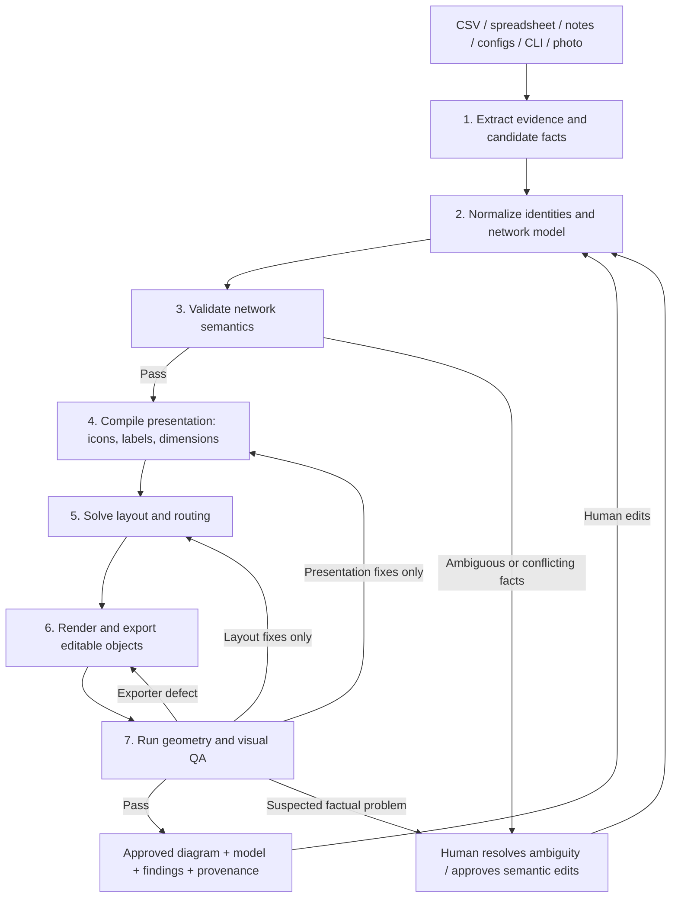

# Architecture for accurate network diagrams

**Your layering hypothesis is a strong engineering explanation, but the recommended solution is closer to a compiler with two bounded AI assistants than a swarm of diagramming agents.** Use Python to maintain a validated network model, compile it into a measured scene, and export editable objects; use an LLM only to interpret ambiguous input and critique rendered output. NetBox’s separation of intended state from automation, and Batfish’s parsing-to-analysis pipeline, provide established precedents for this architecture—not proof of LLM diagramming performance.[^1_1][^1_2][^1_3]

> **Evidence boundaries**
>
> - **Verified:** Capabilities and licensing explicitly supported by the linked documentation below.
> - **User observation:** Your Network Sketcher and TopoViewer trials; not independently reproduced here.
> - **Recommendation:** The proposed architecture, schema, algorithms, acceptance criteria, and effort estimates.
> - **Unverified:** Several requested products’ current licenses, maintenance details, and export capabilities. These are marked rather than guessed.
>
> This is an architecture and implementation-design report, not a completed product benchmark or license audit. The academic-literature portion remains a verification gap: no empirical LLM diagram-generation paper was independently inspected, so no benchmark percentages or paper-specific findings are asserted.

## Executive architecture

The recommended first stack is **Python + a versioned JSON model + deterministic role-based layout + draw.io XML**, with SVG/PNG previews generated from the same scene. Add a browser editor, advanced layout engine, discovery adapters, and native Office exporters only after the basic model and round trip work.

The important architectural decisions are:


| Decision | Recommendation | Reason |
| :-- | :-- | :-- |
| Authoritative representation | Versioned semantic JSON, initially stored in Git | Easier to test and review than treating diagram XML as network truth |
| Persistent enterprise source of truth | Optional NetBox or Nautobot adapter | Avoid requiring a full platform for the first useful diagram |
| LLM responsibilities | Ambiguous extraction and visual critique | Neither task should have authority to silently alter approved network facts |
| Exact responsibilities | Python validation, identity resolution, label generation, layout constraints, export, comparison | These can be expressed as explicit rules and invariants |
| Initial layout | A small number of excellent deterministic templates | A ten-device enterprise diagram does not require an unrestricted general-purpose layout optimizer |
| Initial editable format | `.drawio` with stable IDs and metadata | The format exposes diagram cells, geometry, connections, and custom user-object data.[^1_4] |
| Advanced layout | Evaluate ELK/elkjs after the template baseline | A layout engine should receive measured objects and constraints, not raw prose |
| Visio | Optional native-object back end | Do not make the first working version depend on native `.vsdx` generation |
| Quality control | Semantic gates → geometry gates → visual critic → human approval | A polished image must not conceal invalid topology |
| Round trip | Structured edit operations and three-way merge | Dragging a device and changing an IP are fundamentally different changes |

**The most important limitation:** an IP list is not a physical topology. With no adjacency evidence, the system should produce a polished **inventory or subnet-membership diagram**, not invent switch connections.

### Pipeline diagram



The diagram shows a proposed control flow. In implementation, semantic edits and view-only edits should enter different APIs rather than indiscriminately restarting every stage.

## What the landscape establishes

The useful precedent is not that commercial tools “draw better.” It is that they generally operate on structured objects and constrained workflows. NetBox explicitly separates network modeling from interaction with devices, while Batfish documents distinct parsing, extraction, vendor-independent modeling, data-plane generation, and analysis stages.[^1_1][^1_2]

Your two trials expose different boundaries:

- **Network Sketcher:** Your observation suggests strong semantic handling but insufficient presentation for your purpose.
- **TopoViewer:** Your observation suggests a useful visual surface without the semantic assurance and layout behavior you need.
- **Inference:** Combining their screenshots or prompting either harder would not address the missing contract between network semantics, presentation dimensions, and layout.

“Clean output” also needs qualification. A diagram can be attractive, editable, or operationally correct without being all three.

### Discovery and source-of-truth tools

“Quality” below means architectural fit or documented output type—not an independently measured visual-quality score.


| Candidate | Layer and input → output | Quality / recommended role | License and maintenance evidence |
| :-- | :-- | :-- | :-- |
| **HP OpenView / Network Node Manager** | Historical NMS/topology benchmark named in the brief | Study the structured-discovery precedent; not a proposed dependency | A legacy HP support document was located, but current product lineage, APIs, exports, and licensing were not verified.[^1_5] |
| **SolarWinds** | Monitored entities and relationships → operational maps | Commercial reference for relationship-driven maps | Official documentation says **Network Atlas is deprecated** and recommends **Intelligent Maps**; the two should not be treated as the same current offering.[^1_6][^1_7] |
| **NetBrain** | Commercial discovery/automation candidate from the brief | Evaluate as an integrated alternative, not a reusable open-source layout component | Current APIs, export semantics, licensing, and maintenance were not independently verified |
| **Visio network add-ons** | Discovery/data connectors → Visio objects, depending on product | Potential shortcut if editable Visio is the dominant requirement | Product-specific evaluation required; no add-on was sufficiently verified to recommend |
| **[NetBox](https://github.com/netbox-community/netbox)** | Intended network state → linked objects and programmable interfaces | Strong eventual enterprise authority; not a substitute for discovery or layout | Apache-2.0 verified. The repository documents devices, cables, IP addresses, VLANs, custom validation, change logging, and configuration rendering.[^1_1] |
| **[Nautobot](https://github.com/nautobot/nautobot/tree/main)** | Intended network state and automation → API objects, jobs, integrations | Strong alternative where automation jobs and model extensions are central | Open-source status and platform capabilities verified; exact license text not inspected. A September 2026 release merge provides recent maintenance evidence.[^1_8][^1_9][^1_10] |
| **[netbox-topology-views](https://github.com/netbox-community/netbox-topology-views)** | NetBox devices/cables → topology views; draw.io XML or PNG export | Closest verified reuse candidate when NetBox is already present | Apache-2.0 documented; release 5.0.2 activity dated November 8, 2026. Documentation says connections derive from NetBox cables.[^1_11][^1_12][^1_13] |
| **Cobalt Strike** | Red-team visualization benchmark raised in the brief | Do not use its appearance as evidence of general network validation or reusable layout capability | Neither its diagramming internals nor relevant export behavior was verified |

**Recommendation:** If you already maintain reliable cable and interface data in NetBox, prototype from `netbox-topology-views` before building another editor. If you do not, start with a small JSON model rather than deploying NetBox merely to draw ten devices.

### Collection and semantic analysis

| Candidate | Layer and input → output | Recommended role | License / maintenance evidence |
| :-- | :-- | :-- | :-- |
| **[Batfish](https://github.com/batfish/batfish)** | Configuration snapshots → parsed models and network analysis | Optional deeper validation after basic IP/VLAN/link checks | Apache-2.0 verified; documented as configuration analysis, not a presentation engine.[^1_14][^1_3][^1_2] |
| **[NAPALM](https://github.com/napalm-automation/napalm)** | Vendor devices → a unified Python interaction interface and retrieved data | Preferred adapter where supported getters provide the required facts | Apache-2.0 verified; repository documents supported-platform caveats and maintainers.[^1_15][^1_16] |
| **[Netmiko](https://github.com/ktbyers/netmiko)** | Device CLI sessions → command output; optionally configuration changes | Collection transport, not topology authority | MIT identified in repository; current README documents installation and platform support.[^1_17][^1_18] |
| **pyATS / [Genie Parser](https://github.com/CiscoTestAutomation/genieparser)** | Device output → structured data; broader testing ecosystem | Rich parser/test adapter where it fits the vendor and command set | **Genie Parser** Apache-2.0 verified. Do not assume that verifies every pyATS runtime component or redistribution condition.[^1_19] |
| **[TextFSM](https://github.com/google/textfsm)** | Semi-structured CLI text + template → tables | Lightweight deterministic parser | Apache-2.0 verified; template-based parsing documented.[^1_20][^1_21] |
| **[ntc-templates](https://github.com/networktocode/ntc-templates)** | Device command output → parsed records through templates | Reuse command-specific parsing rather than asking an LLM to parse every run | Template purpose and recent repository activity verified; license confirmation should use the pinned upstream release, not a fork’s license file.[^1_22][^1_23][^1_24] |
| **[Containerlab](https://github.com/srl-labs/containerlab)** | Declarative topology files → deployed lab wiring and lifecycle operations | Lab export and test environment; not the entire canonical model | Topology schema and orchestration purpose verified; exact project license not inspected. Its documentation describes Linux/Docker operation.[^1_25][^1_26][^1_27] |

A significant warning appears in Genie Parser’s own documentation: some example regex patterns can match invalid-looking IP strings. **Successful parsing is therefore not equivalent to valid addressing.**[^1_19]

### Diagram generators and canvases

For candidates not independently checked, the table specifies the **adapter to investigate**, not a guaranteed native capability or license.


| Candidate | Layer / adapter boundary | Fit for this pipeline | Verification status |
| :-- | :-- | :-- | :-- |
| **[Cisco Network Sketcher](https://github.com/cisco-open/network-sketcher)** | Network design engine, including a Local MCP interface | Evaluate as a semantic/design adapter or alternative pipeline foundation | Apache-2.0 and Local MCP support verified; 2026 releases documented. Visual quality was not independently benchmarked.[^1_28][^1_29] |
| **[TopoViewer: netpilot-labs](https://github.com/netpilot-labs/TopoViewer)** | Visual topology editor candidate | Potential presentation shell; add validation outside it | Repository workflow activity was located. React Flow behavior and quality observations here come from your trial; license and exact export contracts remain unverified.[^1_30][^1_31] |
| **Containerlab React TopoViewer** | Containerlab-oriented visual editing | Related but **not necessarily the TopoViewer you tested** | Source imports React Flow. The older `vscode-containerlab` repository was archived November 5, 2026.[^1_32][^1_33] |
| **[Containerlab app](https://github.com/srl-labs/containerlab-app)** | Canvas and topology YAML | Important round-trip reference implementation | Documentation explicitly describes canvas and YAML as synchronized views of the same file; license not inspected.[^1_34] |
| **Diagrams-as-code** | Proposed Python/model → generated diagram adapter | Useful comparison baseline; do not make its diagram source the network authority | Exact release, license, editable export, and layout limits not independently checked |
| **D2** | Proposed canonical model → DSL → rendered output | Candidate text-source back end | Current license, engines, and round-trip editing behavior not independently checked |
| **[PlantUML nwdiag](https://plantuml.com/nwdiag)** | Text network description → network diagram | Useful subnet-centric baseline | Networks, addresses, grouping, shapes, and some icon syntax documented; 2026 project changes verified. Edition-specific licensing not inspected.[^1_35][^1_36] |
| **Graphviz** | Proposed graph → positioned graph/scene adapter | Candidate baseline for hierarchical layout | Current license and exact geometry/export contract not independently checked |
| **ELK / elkjs** | Proposed measured graph + constraints → layout result | Priority advanced-layout candidate | License, version, constraints, label behavior, and pinning require a prototype and audit |
| **Cytoscape.js** | Proposed graph → interactive view/layout adapter | Candidate graph-oriented browser surface | Current license and extension licenses not independently checked |
| **React Flow** | Proposed nodes/ports/edges → editable browser canvas | Priority custom-editor candidate, **not the semantic validator** | Its use in Containerlab source is verified; its own current license/API documentation was not independently inspected.[^1_32][^1_33] |
| **yFiles** | Proposed measured graph → layout/editor adapter | Commercial fallback if layout engineering becomes the bottleneck | Current terms and features not independently checked |
| **GoJS** | Proposed model → diagram/editor adapter | Commercial alternative for integrated editing | Current terms and features not independently checked |
| **N2G** | Proposed Python topology → diagram-format adapter | Priority reuse investigation for draw.io-oriented output | Current upstream APIs, license, release activity, and metadata preservation not sufficiently verified |
| **[draw.io](https://github.com/jgraph/drawio/wiki/File-Format)** | XML cell model ↔ editable diagram; image exports | Recommended first exchange/editor format | Cell IDs, user objects, geometry-related structure, and embedded diagram data documented; application and asset licenses still require separate review.[^1_4][^1_37] |

**Licensing conclusion:** The verified permissive components already justify a viable semantic core, but this research does **not** establish that every proposed layout, canvas, exporter, and icon asset satisfies your licensing constraint. Treat that as a release gate, not an assumption.

### AI-native efforts

The clearest verified AI-native example in this research is Network Sketcher’s Local MCP edition, which exposes its engine to LLM clients through a tool interface.[^1_28][^1_29]

For the proposed system:

- **MCP should expose bounded operations**, such as `extract_candidates`, `validate_model`, `render_view`, and `propose_layout_patch`.
- **An agent framework is optional.** A Python state machine with typed requests, artifact hashes, retry limits, and approval gates is sufficient initially.
- **No LLM should emit unrestricted exporter code** or execute arbitrary commands from uploaded configurations.
- **No academic superiority claim is justified yet.** A reviewed literature search and controlled benchmark remain necessary before claiming this design outperforms specific published systems.

The architectural value of an agent framework would be orchestration and traceability—not better IP mathematics.

## Why one-pass generation fails

The following is an **engineering explanation to test**, not a claim that a particular study established each mechanism.

### Distinct correctness problems

A single diagram request hides several different tasks:


| Task | What correctness means | Appropriate mechanism |
| :-- | :-- | :-- |
| Interpret messy notes | Capture intended entities and uncertainty | LLM-assisted extraction with evidence references |
| Resolve identities | Determine whether two names refer to one device | Deterministic rules plus human review for ambiguity |
| Validate addresses | Correct syntax, prefix membership, scoped uniqueness | Python rules |
| Establish topology | Distinguish actual adjacency from membership or reachability | Evidence-backed model |
| Place objects | Respect dimensions, groups, ranks, ports, and constraints | Layout algorithm |
| Assign icons | Match approved device classification to an approved asset | Registry lookup |
| Render | Preserve geometry, text, connections, and metadata | Exporter |
| Judge readability | Determine whether the result communicates effectively | Geometry checks, visual critic, human assessment |

An LLM can generate syntactically plausible diagram code while none of the later mechanisms has actually run.

### Missing measurements

A layout algorithm cannot reserve the right space if it does not know the final icon dimensions, font metrics, line wrapping, interface-label sizes, and group-header padding.

**Recommendation:** Compile styling and label dimensions **before** layout. Treat every visible label as a positioned object, not an afterthought attached to an already positioned edge.

### Missing semantic boundaries

The brief’s failures are consistent with conflating:

- Physical cable adjacency.
- L2 broadcast-domain membership.
- L3 interface addressing.
- Routing or reachability relationships.
- Management-network membership.
- Visual grouping.

**Recommendation:** Store these as separate relation types. Do not create an Ethernet cable merely because two addresses share a prefix.

### Where LLMs belong

Use an LLM to propose structure from “the firewall connects to the old core,” interpret a photographed whiteboard, or flag that a rendered diagram feels visually unbalanced.

Do not use it as the final authority for subnet calculations, duplicate-address detection, object IDs, connector endpoints, or icon-file selection. Python’s `ipaddress` module explicitly supplies address, interface, and network representations and operations for the exact-addressing portion.[^1_38][^1_1]

## Seven-layer design

All layers should produce immutable artifacts. The orchestrator should advance a revision only when the applicable gate passes.


| Layer | Single job | Input → output | Implementation | Self-validation |
| :-- | :-- | :-- | :-- | :-- |
| **1. Evidence extraction** | Convert input into attributable candidate facts | Files/text/images → `evidence.json` + `candidates.json` | Deterministic adapters first; LLM only for ambiguity or vision | Every candidate has a source locator; ambiguous fields remain unresolved |
| **2. Model normalization** | Establish identities and typed relationships | Candidates + existing model → `candidate-topology.json` | Python | Schema, foreign keys, stable IDs, type rules, reconciliation report |
| **3. Semantic validation** | Determine whether proposed network facts satisfy rules | Candidate topology → approved model + `findings.json` | Python; optional Batfish adapter | IP/VLAN/link rules; evidence coverage; explicit exceptions |
| **4. Presentation compilation** | Turn selected semantics into measurable visual objects | Approved model + view + theme → `scene-spec.json` | Python | Correct labels, approved icon mapping, complete dimensions, coverage manifest |
| **5. Layout** | Assign geometry to the measured scene | Scene specification + constraints → `layout.json` | Python templates initially; optional external engine | No illegal collisions, invalid endpoints, clipped objects, or violated hard constraints |
| **6. Rendering/export** | Encode the same scene into target formats | Scene + layout → draw.io/SVG/PNG/PPTX/Visio | Deterministic exporters | Reopen, parse, compare IDs/text/connections, render smoke test |
| **7. Quality assurance** | Detect remaining communication or rendering defects | Model + scene + rendered image → `qa.json` or bounded patch | Geometry scripts first; vision critic second | Hard gates remain passed; fixes are allowed, attributable, and bounded |

### Artifact contract

Every artifact should include:

```json
{
  "artifact_type": "layout",
  "schema_version": "1.0",
  "model_revision": 17,
  "view_id": "physical-main",
  "input_hashes": {
    "topology": "mputed hash>",
    "scene": "mputed hash>",
    "theme": "mputed hash>"
  },
  "producer": {
    "name": "layout-template-enterprise",
    "version": "0.1.0"
  },
  "issues": [],
  "payload": {}
}
```

The hashes above are placeholders describing fields to compute, not fabricated example results.

### Authority boundaries

- Extraction proposes facts; it does not approve them.
- Normalization cannot resolve uncertainty by making up a prefix length.
- Validation reports or rejects; it does not silently “repair” addresses.
- Presentation may abbreviate a displayed interface name, but must preserve its full source value.
- Layout may move a firewall, not reclassify it as a switch.
- A visual critic may request more spacing, not change an IP because another value looks more plausible.
- Only an approved semantic-edit operation changes the authoritative model.


## Intermediate model

**Recommendation:** Use a compact JSON domain model inspired by NetBox and RFC 8345, rather than adopting either wholesale.

NetBox provides a broad linked model for network infrastructure. RFC 8345 provides networks, nodes, links, and termination points, including supporting relationships between topology layers; its links are point-to-point and unidirectional.[^1_1][^1_39]

### Existing-model choices

| Model | Useful reuse | What the proposed system still needs |
| :-- | :-- | :-- |
| **NetBox** | Devices, interfaces, cables, addressing, VLANs, intended state | Extraction uncertainty, field-level evidence, multiple view specifications, layout pins, QA findings, exporter metadata |
| **Nautobot** | Intended state, extensions, validation rules, automation integration | The same presentation and evidence contracts; assess whether its automation platform is desirable overhead.[^1_8][^1_9] |
| **Containerlab YAML** | Lab nodes, endpoints, deployment properties, schema validation | A broader distinction between inventory, physical topology, logical topology, evidence, and presentation. Containerlab’s documented purpose is lab definition and deployment.[^1_25][^1_27] |
| **RFC 8345 / YANG** | Standard topology concepts and layered references | Application-specific augmentations and adapters. A bidirectional physical cable must be mapped deliberately to the standard’s unidirectional links.[^1_39] |
| **draw.io XML** | Editable presentation objects and custom data | Network meaning and validation must live outside the drawing format.[^1_4] |

### Recommended entities

| Entity | Important fields |
| :-- | :-- |
| `Source` | ID, filename/URI, content hash, capture time, source type, sensitivity |
| `Evidence` | Source ID, row/line/page/region locator, extraction method |
| `Device` | Stable ID, name, aliases, role, vendor/model when known, site |
| `Interface` | Stable ID, device ID, canonical name, kind, parent, VRF, L2 configuration |
| `Address` | Interface ID, address/prefix length, prefix reference, role, state |
| `Prefix` | CIDR, VRF, scope, optional VLAN reference |
| `VLAN` | Internal ID, numeric VID, namespace/site, name |
| `Link` | Stable ID, relation type, endpoints, directionality, evidence |
| `Membership` | Interface/device participation in a segment or other logical grouping |
| `Assertion` | Subject, property, value, evidence, epistemic status |
| `Finding` | Rule, severity, affected IDs, expected/actual, evidence |
| `View` | Selection, projection, grouping, labels, pins, overrides |
| `SceneObject` | Entity reference, visual role, dimensions, text, icon reference |
| `LayoutObject` | Scene ID, coordinates, route points, label boxes |

### Required distinctions

**Observed versus intended:** Keep separate snapshots or explicit state fields. A desired cable is not evidence that a cable exists.

**Unknown versus absent:** `vendor: null` means unknown. An empty interface-address list means no address recorded, not necessarily proof that the interface is unnumbered.

**Address uniqueness scope:** Key address checks by the appropriate routing context and explicitly model exceptions such as approved shared virtual addresses. A global “no repeated address string” rule is too crude.

**VLAN identity:** Use an internal VLAN ID plus a namespace. Do not assume VLAN 10 at two unrelated sites is one broadcast domain.

**Identity versus label:** Device names can change. Stable device IDs must not.

**Confidence versus evidence:** An LLM confidence number is not a calibrated probability. Preserve the actual source and uncertainty category.

## Ten-device worked example

The following is an **authored hypothetical fixture**, as requested—not discovered inventory or a measured result.

### Initial IP list

| ID | Device | Role stated in notes | Primary address |
| :-- | :-- | :-- | :-- |
| d01 | EDGE-01 | Router | 192.0.2.1/30 |
| d02 | FW-01 | Firewall | 10.255.0.2/30 |
| d03 | CORE-01 | Core switch | 10.10.99.1/24 |
| d04 | DIST-01 | Distribution switch | 10.10.99.11/24 |
| d05 | DIST-02 | Distribution switch | 10.10.99.12/24 |
| d06 | ACCESS-01 | Access switch | 10.10.99.21/24 |
| d07 | ACCESS-02 | Access switch | 10.10.99.22/24 |
| d08 | AP-01 | Access point | 10.10.99.31/24 |
| d09 | APP-01 | Server | 10.10.20.10/24 |
| d10 | PC-01 | Workstation | 10.10.10.10/24 |

From this list alone, the valid first output is a subnet-membership/inventory view. **None of the nine physical links below follows from those ten IP addresses.**

### Supplemental authored notes

For the physical-topology example, assume the input also explicitly supplies:

- EDGE-01 `Gi0/1` is `10.255.0.1/30` and connects to FW-01 `outside`.
- FW-01 `inside` is `10.255.0.5/30` and connects to CORE-01 `Gi0/0`, `10.255.0.6/30`.
- CORE-01 has gateway SVIs `10.10.10.1/24`, `10.10.20.1/24`, and `10.10.99.1/24`.
- CORE-01 connects separately to DIST-01 and DIST-02.
- DIST-01 connects to ACCESS-01; DIST-02 connects to ACCESS-02.
- ACCESS-01 connects to AP-01 on VLAN 99 and PC-01 on VLAN 10.
- ACCESS-02 connects to APP-01 on VLAN 20.
- Switch uplinks use native VLAN 99; the permitted tagged VLANs are specified in the profiles below.
- Vendor and hardware-model information is not supplied.

The last point requires **generic role-correct icons**, not invented Cisco hardware imagery.

### Concrete JSON representation

This compact example includes all ten devices, their relevant interfaces and addresses, and nine explicitly authored physical links. Production documents should additionally attach field-level evidence; the fixture uses document-level source attribution for readability.

```json
{
  "schema_version": "1.0",
  "model_id": "example-ten-device-network",
  "revision": 1,
  "state": "intended",
  "sources": {
    "src-list": {
      "kind": "authored-example",
      "description": "Ten-device IP list"
    },
    "src-notes": {
      "kind": "authored-example",
      "description": "Supplemental interface and adjacency notes"
    }
  },
  "default_evidence_refs": ["src-list", "src-notes"],
  "sites": {
    "s01": {"name": "Example site"}
  },
  "vrfs": {
    "v00": {"name": "default"}
  },
  "vlan_namespaces": {
    "vn01": {"site_id": "s01", "name": "site-local"}
  },
  "vlans": {
    "vl10": {"vid": 10, "namespace_id": "vn01", "name": "Users"},
    "vl20": {"vid": 20, "namespace_id": "vn01", "name": "Servers"},
    "vl99": {"vid": 99, "namespace_id": "vn01", "name": "Management"}
  },
  "prefixes": {
    "p-wan": {"cidr": "192.0.2.0/30", "vrf_id": "v00"},
    "p-ef": {"cidr": "10.255.0.0/30", "vrf_id": "v00"},
    "p-fc": {"cidr": "10.255.0.4/30", "vrf_id": "v00"},
    "p-users": {
      "cidr": "10.10.10.0/24", "vrf_id": "v00", "vlan_id": "vl10"
    },
    "p-servers": {
      "cidr": "10.10.20.0/24", "vrf_id": "v00", "vlan_id": "vl20"
    },
    "p-mgmt": {
      "cidr": "10.10.99.0/24", "vrf_id": "v00", "vlan_id": "vl99"
    }
  },
  "l2_profiles": {
    "trunk-all": {
      "mode": "trunk",
      "untagged_vlan_id": "vl99",
      "tagged_vlan_ids": ["vl10", "vl20"]
    },
    "trunk-users": {
      "mode": "trunk",
      "untagged_vlan_id": "vl99",
      "tagged_vlan_ids": ["vl10"]
    },
    "trunk-servers": {
      "mode": "trunk",
      "untagged_vlan_id": "vl99",
      "tagged_vlan_ids": ["vl20"]
    },
    "access-users": {
      "mode": "access",
      "untagged_vlan_id": "vl10",
      "tagged_vlan_ids": []
    },
    "access-servers": {
      "mode": "access",
      "untagged_vlan_id": "vl20",
      "tagged_vlan_ids": []
    },
    "access-mgmt": {
      "mode": "access",
      "untagged_vlan_id": "vl99",
      "tagged_vlan_ids": []
    }
  },
  "devices": {
    "d01": {
      "name": "EDGE-01", "role": "router", "site_id": "s01",
      "vendor": null, "primary_address_id": "a01"
    },
    "d02": {
      "name": "FW-01", "role": "firewall", "site_id": "s01",
      "vendor": null, "primary_address_id": "a03"
    },
    "d03": {
      "name": "CORE-01", "role": "core-switch", "site_id": "s01",
      "vendor": null, "primary_address_id": "a08"
    },
    "d04": {
      "name": "DIST-01", "role": "distribution-switch", "site_id": "s01",
      "vendor": null, "primary_address_id": "a09"
    },
    "d05": {
      "name": "DIST-02", "role": "distribution-switch", "site_id": "s01",
      "vendor": null, "primary_address_id": "a10"
    },
    "d06": {
      "name": "ACCESS-01", "role": "access-switch", "site_id": "s01",
      "vendor": null, "primary_address_id": "a11"
    },
    "d07": {
      "name": "ACCESS-02", "role": "access-switch", "site_id": "s01",
      "vendor": null, "primary_address_id": "a12"
    },
    "d08": {
      "name": "AP-01", "role": "access-point", "site_id": "s01",
      "vendor": null, "primary_address_id": "a13"
    },
    "d09": {
      "name": "APP-01", "role": "server", "site_id": "s01",
      "vendor": null, "primary_address_id": "a14"
    },
    "d10": {
      "name": "PC-01", "role": "workstation", "site_id": "s01",
      "vendor": null, "primary_address_id": "a15"
    }
  },
  "interfaces": {
    "i01": {"device_id": "d01", "name": "Gi0/0", "kind": "routed", "vrf_id": "v00"},
    "i02": {"device_id": "d01", "name": "Gi0/1", "kind": "routed", "vrf_id": "v00"},
    "i03": {"device_id": "d02", "name": "outside", "kind": "routed", "vrf_id": "v00"},
    "i04": {"device_id": "d02", "name": "inside", "kind": "routed", "vrf_id": "v00"},
    "i05": {"device_id": "d03", "name": "Gi0/0", "kind": "routed", "vrf_id": "v00"},
    "i06": {"device_id": "d03", "name": "Gi0/1", "kind": "switchport", "l2_profile_id": "trunk-all"},
    "i07": {"device_id": "d03", "name": "Gi0/2", "kind": "switchport", "l2_profile_id": "trunk-all"},
    "i08": {"device_id": "d03", "name": "Vlan10", "kind": "svi", "vrf_id": "v00", "vlan_id": "vl10"},
    "i09": {"device_id": "d03", "name": "Vlan20", "kind": "svi", "vrf_id": "v00", "vlan_id": "vl20"},
    "i10": {"device_id": "d03", "name": "Vlan99", "kind": "svi", "vrf_id": "v00", "vlan_id": "vl99"},
    "i11": {"device_id": "d04", "name": "Gi0/1", "kind": "switchport", "l2_profile_id": "trunk-all"},
    "i12": {"device_id": "d04", "name": "Gi0/2", "kind": "switchport", "l2_profile_id": "trunk-users"},
    "i13": {"device_id": "d04", "name": "Vlan99", "kind": "svi", "vrf_id": "v00", "vlan_id": "vl99"},
    "i14": {"device_id": "d05", "name": "Gi0/1", "kind": "switchport", "l2_profile_id": "trunk-all"},
    "i15": {"device_id": "d05", "name": "Gi0/2", "kind": "switchport", "l2_profile_id": "trunk-servers"},
    "i16": {"device_id": "d05", "name": "Vlan99", "kind": "svi", "vrf_id": "v00", "vlan_id": "vl99"},
    "i17": {"device_id": "d06", "name": "Gi0/1", "kind": "switchport", "l2_profile_id": "trunk-users"},
    "i18": {"device_id": "d06", "name": "Gi0/2", "kind": "switchport", "l2_profile_id": "access-mgmt"},
    "i19": {"device_id": "d06", "name": "Gi0/3", "kind": "switchport", "l2_profile_id": "access-users"},
    "i20": {"device_id": "d06", "name": "Vlan99", "kind": "svi", "vrf_id": "v00", "vlan_id": "vl99"},
    "i21": {"device_id": "d07", "name": "Gi0/1", "kind": "switchport", "l2_profile_id": "trunk-servers"},
    "i22": {"device_id": "d07", "name": "Gi0/2", "kind": "switchport", "l2_profile_id": "access-servers"},
    "i23": {"device_id": "d07", "name": "Vlan99", "kind": "svi", "vrf_id": "v00", "vlan_id": "vl99"},
    "i24": {"device_id": "d08", "name": "eth0", "kind": "host", "vrf_id": "v00", "l2_profile_id": "access-mgmt"},
    "i25": {"device_id": "d09", "name": "eth0", "kind": "host", "vrf_id": "v00", "l2_profile_id": "access-servers"},
    "i26": {"device_id": "d10", "name": "eth0", "kind": "host", "vrf_id": "v00", "l2_profile_id": "access-users"}
  },
  "addresses": {
    "a01": {"interface_id": "i01", "value": "192.0.2.1/30", "prefix_id": "p-wan"},
    "a02": {"interface_id": "i02", "value": "10.255.0.1/30", "prefix_id": "p-ef"},
    "a03": {"interface_id": "i03", "value": "10.255.0.2/30", "prefix_id": "p-ef"},
    "a04": {"interface_id": "i04", "value": "10.255.0.5/30", "prefix_id": "p-fc"},
    "a05": {"interface_id": "i05", "value": "10.255.0.6/30", "prefix_id": "p-fc"},
    "a06": {"interface_id": "i08", "value": "10.10.10.1/24", "prefix_id": "p-users"},
    "a07": {"interface_id": "i09", "value": "10.10.20.1/24", "prefix_id": "p-servers"},
    "a08": {"interface_id": "i10", "value": "10.10.99.1/24", "prefix_id": "p-mgmt"},
    "a09": {"interface_id": "i13", "value": "10.10.99.11/24", "prefix_id": "p-mgmt"},
    "a10": {"interface_id": "i16", "value": "10.10.99.12/24", "prefix_id": "p-mgmt"},
    "a11": {"interface_id": "i20", "value": "10.10.99.21/24", "prefix_id": "p-mgmt"},
    "a12": {"interface_id": "i23", "value": "10.10.99.22/24", "prefix_id": "p-mgmt"},
    "a13": {"interface_id": "i24", "value": "10.10.99.31/24", "prefix_id": "p-mgmt"},
    "a14": {"interface_id": "i25", "value": "10.10.20.10/24", "prefix_id": "p-servers"},
    "a15": {"interface_id": "i26", "value": "10.10.10.10/24", "prefix_id": "p-users"}
  },
  "links": {
    "l01": {"kind": "physical", "endpoint_ids": ["i02", "i03"], "evidence_refs": ["src-notes"]},
    "l02": {"kind": "physical", "endpoint_ids": ["i04", "i05"], "evidence_refs": ["src-notes"]},
    "l03": {"kind": "physical", "endpoint_ids": ["i06", "i11"], "evidence_refs": ["src-notes"]},
    "l04": {"kind": "physical", "endpoint_ids": ["i07", "i14"], "evidence_refs": ["src-notes"]},
    "l05": {"kind": "physical", "endpoint_ids": ["i12", "i17"], "evidence_refs": ["src-notes"]},
    "l06": {"kind": "physical", "endpoint_ids": ["i15", "i21"], "evidence_refs": ["src-notes"]},
    "l07": {"kind": "physical", "endpoint_ids": ["i18", "i24"], "evidence_refs": ["src-notes"]},
    "l08": {"kind": "physical", "endpoint_ids": ["i19", "i26"], "evidence_refs": ["src-notes"]},
    "l09": {"kind": "physical", "endpoint_ids": ["i22", "i25"], "evidence_refs": ["src-notes"]}
  },
  "views": {
    "physical-main": {
      "projection": "physical",
      "device_ids": ["d01", "d02", "d03", "d04", "d05", "d06", "d07", "d08", "d09", "d10"],
      "layout_policy": "enterprise-role-hierarchy",
      "show_primary_addresses": true,
      "show_interface_labels": true,
      "show_vlan_labels": true,
      "show_svi_panel": true,
      "pins": {}
    }
  }
}
```


### Expected interpretation

The intended physical view is:

```text
                    EDGE-01
                       |
                     FW-01
                       |
                    CORE-01
                   /       \
              DIST-01     DIST-02
                 |           |
             ACCESS-01   ACCESS-02
              /    \          |
           AP-01  PC-01      APP-01
```

CORE-01’s three SVIs belong in an attached interface panel or a separate logical view. They should not become three extra physical devices.

The fixture contains enough information to test subnet membership, transit addressing, VLAN profiles, referential integrity, and physical-link endpoints. It does **not** establish routing correctness, firewall policy, actual reachability, or live device state. No automated validation run is claimed here.

## Python backbone

Use Python as the orchestrator and semantic authority. A small external layout or rendering process does not undermine that choice; the important boundary is that its inputs and outputs are typed and checked.

The following libraries are **implementation candidates**, not a completed dependency-license audit.


| Function | Preferred building blocks | Implementation boundary |
| :-- | :-- | :-- |
| CSV intake | Standard-library `csv` | Explicit column mapping and row-level errors |
| Spreadsheet intake | `openpyxl`; optionally `pandas` | Preserve sheet/cell provenance and original values |
| Typed model | `pydantic` or `dataclasses` + `jsonschema` | Schema validation is separate from network validation |
| IP/subnet operations | Standard-library `ipaddress` | Parse addresses as interfaces; validate prefixes as networks.[^1_38][^1_1] |
| CLI collection | Netmiko or NAPALM | Read-only collection credentials by default.[^1_17][^1_16] |
| CLI parsing | TextFSM/ntc-templates or Genie Parser | Preserve raw output alongside parsed records.[^1_20][^1_19] |
| Graph analysis | `networkx` candidate | Components, reachability within the model, rank derivation |
| Config assurance | Batfish adapter | Only for supported, sufficiently complete configuration snapshots.[^1_3][^1_2] |
| Geometry | `shapely` candidate | Rectangle/segment tests and spatial indexing |
| Font measurement | `Pillow`, `fontTools`, or actual browser measurement | Verify measurements against the final renderer |
| draw.io generation | `xml.etree.ElementTree` or `lxml` | Write native cells, ports/anchors, labels, and stable metadata |
| SVG generation | XML writer or an SVG library | Retain scene IDs and explicit text objects |
| Browser rendering/QA | `playwright` candidate | Capture actual output and measure DOM/SVG geometry |
| PowerPoint | `python-pptx` candidate | Generate native objects, not a single slide-sized image |
| Visio desktop automation | `pywin32` candidate | Optional licensed Windows worker; prototype support conditions |
| Safe imported XML | `defusedxml` candidate | Reject unsafe constructs and excessive resource use |
| Tests | `pytest`, `hypothesis` candidates | Unit, property, mutation, and round-trip tests |

### Suggested command contracts

```text
netdiag ingest input.csv --mapping columns.yaml
    -> evidence.json, candidates.json

netdiag normalize candidates.json --base topology.json
    -> candidate-topology.json, reconciliation.json

netdiag validate candidate-topology.json --policy policy.yaml
    -> findings.json, approved-topology.json

netdiag compile approved-topology.json --view physical-main --theme theme.yaml
    -> scene-spec.json

netdiag layout scene-spec.json --policy enterprise-role-hierarchy
    -> layout.json

netdiag export scene-spec.json layout.json --formats drawio,svg,png
    -> editable diagram, previews, export-manifest.json

netdiag qa approved-topology.json scene-spec.json layout.json rendered.png
    -> qa.json

netdiag import-edits edited.drawio --base-revision 17
    -> proposed-operations.json, merge-report.json
```

The implementation should expose the same operations through a CLI, an HTTP API, and—if useful—an MCP interface. Do not implement separate semantic logic in each interface.

## Semantic validation

Build validation as named rules with explicit applicability and exceptions.

### Address and subnet rules

| Rule family | Required behavior |
| :-- | :-- |
| Syntax | Reject invalid IPv4/IPv6 address and prefix notation |
| Host preservation | Parse `10.10.20.10/24` as an interface address, not merely its containing network |
| Prefix membership | Check the address against its declared prefix and routing context |
| Prefix agreement | Flag an interface mask inconsistent with its declared addressing plan |
| Duplicate addresses | Check within the correct scope; require explicit shared-address exceptions |
| Host usability | Apply policy appropriate to interface type and prefix length |
| Routed links | For applicable numbered point-to-point links, check address-family and subnet compatibility |
| Missing information | Record unknown mask, VRF, gateway, or assignment rather than inventing it |
| Overlapping prefixes | Distinguish prohibited conflicts from permitted hierarchy or separate VRFs |

Python’s documentation explicitly distinguishes interface objects from network objects and documents special usable-host behavior for `/31` networks. Avoid implementing the simplistic rule that every subnet always loses two usable addresses.[^1_38][^1_1]

### VLAN and link rules

Recommended checks include:

- All referenced devices, interfaces, VLANs, prefixes, and profiles exist.
- Each physical link has the required endpoint count.
- A physical port is not accidentally assigned to multiple point-to-point cables.
- An SVI is not treated as a physical cable endpoint.
- Access-port VLANs agree with the connected endpoint’s declared membership where known.
- Native/untagged VLAN settings agree where policy requires agreement.
- Required VLANs are carried across the intended switch path.
- A VLAN referenced by an SVI exists in the appropriate namespace.
- Link bundles, breakout ports, shared media, and virtual links use explicit types rather than exceptions hidden in generic edges.
- Unconnected interfaces are not automatically errors; a missing endpoint on a declared link is.


### Validation finding format

```json
{
  "rule_id": "VLAN_NATIVE_MISMATCH",
  "severity": "error",
  "subject_ids": ["l05", "i12", "i17"],
  "evidence_refs": ["src-notes"],
  "expected": "Compatible native VLAN assignments",
  "actual": {
    "i12": "vl99",
    "i17": "vl10"
  },
  "proposed_action": "Request source correction or explicit policy exception",
  "auto_fix_allowed": false
}
```


### What this cannot prove

A consistent IP plan and matching VLAN declarations do not prove that traffic will flow.

Batfish is relevant when the task expands to analyzing device configurations and forwarding behavior; its documented architecture includes data-plane generation and forwarding analysis.[^1_3][^1_2]

**Recommendation:** Publish assurance levels:

1. **Parsed:** Data extracted.
2. **Structurally valid:** Schema and references pass.
3. **Addressing/L2 consistent:** Applicable IP/VLAN checks pass.
4. **Configuration analyzed:** Supported snapshot analysis completed.
5. **Operationally observed:** Relevant live evidence collected.
6. **Human approved:** Scope and exceptions accepted.

A diagram should display its assurance level and snapshot date.

## Layout and label placement

The main design change is to stop treating layout as “give the graph to auto-layout.”

### Compile the view first

Before positioning anything, generate:

- Final device label text.
- Primary-address text.
- Interface and endpoint labels.
- VLAN/trunk labels.
- Icon bounding boxes.
- Text bounding boxes.
- Group-header dimensions.
- Padding and connector-clearance requirements.
- Required information that may move to an attached panel.
- A coverage manifest listing every required visible fact.

A renderer must not choose a different font or wrap text differently without invalidating the layout artifact.

### Start with templates

Recommended initial templates:


| View | Placement policy |
| :-- | :-- |
| Enterprise physical | WAN/edge → security → core → distribution → access → endpoints |
| Subnet inventory | Prefix groups containing members; no implied physical cables |
| Small routed network | Routed devices and numbered transit links |
| Site overview | Site containers with summarized intersite links |
| VLAN logical | Segment membership and gateways; physical detail suppressed |
| Interface detail | One device with port-level relationships |

For the ten-device fixture, the enterprise hierarchy is a better starting point than a free-running force layout.

### Advanced layout contract

If ELK/elkjs or another engine is introduced, give it:

- Measured node sizes.
- Explicit ports or attachment regions.
- Group/container hierarchy.
- Role ranks.
- Edge types.
- Label sizes.
- Spacing requirements.
- Existing positions and pinning requirements where supported.

Evaluate the engine’s actual behavior rather than assuming its advertised feature category implies collision-free output.

### Deterministic label repair

Proposed algorithm:

1. Route edges against node and group obstacles.
2. Generate several candidate positions for each label.
3. Reject candidates intersecting prohibited objects.
4. Score remaining candidates by distance to the associated object, ambiguity, bends, and consistency.
5. Select candidates in a stable order.
6. Expand spacing or reroute when no acceptable candidate exists.
7. Fail the geometry gate if required information still cannot be placed.

A mixed-integer or constraint solver can be considered later, but a stable greedy repair pass may be sufficient for the initial diagram classes.

**Do not promise zero crossings for arbitrary graphs.** Instead, minimize avoidable crossings, distinguish crossings from junctions, and split overloaded diagrams into approved views when necessary.

### Preserve human work

After a user drags a node:

- Save a view-specific pin.
- Recompute incident routes and nearby labels.
- Avoid globally rearranging the drawing.
- Offer “reflow unpinned objects” separately.
- Record when pins make a hard layout constraint unsatisfiable.

This is as important to perceived professionalism as the first automatic layout.

## Styling and icons

Styling should be a registry lookup over approved semantic classifications—not a request for the LLM to find or invent an attractive image.

### Icon registry

```json
{
  "icon_id": "generic.firewall.v1",
  "semantic_roles": ["firewall"],
  "asset_path": "icons/generic/firewall.svg",
  "viewbox": [0, 0, 64, 64],
  "preferred_size": [64, 64],
  "connection_regions": ["north", "south", "east", "west"],
  "license_id": "<verified asset license>",
  "license_source": "<reviewed source URL>",
  "trademark_restrictions": [],
  "asset_hash": "mputed hash>"
}
```


### Mapping policy

| Known information | Allowed mapping |
| :-- | :-- |
| Role only | Generic role icon |
| Vendor known, model unknown | Approved vendor-generic icon, if permitted |
| Vendor and model known | Exact approved asset where available |
| Conflicting classification | Neutral device icon plus finding |
| No classification | Unknown-device icon |
| User override | Explicit override recorded separately from semantic role |

An access switch and a core switch may share a base icon with different role labels. Do not imply an exact chassis model merely to make the picture look more detailed.

### Licensing controls

Maintain separate reviews for:

- Application code.
- Layout libraries and extensions.
- Fonts.
- Generic icons.
- Vendor icons and stencils.
- Trademarks.
- Redistributable export templates.

Network Sketcher’s release history specifically reports removing a GPLv3 dependency because of compatibility concerns with the repository’s Apache-2.0 license. That is a useful warning against assuming the top-level license settles the dependency tree.[^1_29]

**Recommendation:** Begin with an approved generic icon pack. Add Cisco and other vendor assets only after reviewing the specific download terms and redistribution scenario.

## Editable exports

Every exporter should consume the same scene and layout. Avoid a chain such as SVG → PowerPoint → Visio, where semantics and metadata can disappear at each step.


| Format | Required implementation | Editability target | Caveat |
| :-- | :-- | :-- | :-- |
| **draw.io** | Native vertices, edges, labels, custom data | Devices, connections, names, and metadata | Recommended first round-trip format; document structure supports IDs and user objects.[^1_4] |
| **SVG** | Separate identifiable shapes and text | Geometric editing | Generic SVG editing does not, by itself, maintain network semantics |
| **PNG** | Raster preview | None in ordinary image editors | draw.io can embed its diagram data in an exported PNG, but that is embedded source—not editable pixels.[^1_40][^1_4] |
| **PowerPoint** | Native shapes, text, and connectors | Slide objects remain editable | Needs a deliberate metadata/import strategy; a pasted image does not meet the requirement |
| **Visio `.vsdx`** | Native device objects, properties, and glued connectors | Visio-native editing | Requires a dedicated exporter and round-trip prototype |
| **Browser editor** | Scene objects linked to domain IDs | Best controlled semantic editing | Requires custom application behavior; canvas alone is insufficient |

draw.io documents editable `.drawio`/XML files and exports with embedded diagram data in PNG, SVG, and PDF. It also warns that some external processing can strip embedded metadata.[^1_37][^1_40]

### Export acceptance tests

For every target:

1. Export.
2. Reopen with a parser or the target application.
3. Enumerate expected objects.
4. Compare entity IDs.
5. Compare required label text.
6. Compare connection endpoints.
7. Render.
8. Check clipping and font substitution.
9. Make an edit and import it.
10. Confirm that unaffected facts remain unchanged.

A file opening successfully is only the first test.

## Round-trip editing

Round trip is possible only when the system preserves identity and defines what an edit means.

### Separate edit classes

| Human action | Model effect |
| :-- | :-- |
| Drag a device | Change a view position/pin |
| Resize a container | Change view geometry |
| Change displayed abbreviation | Change a presentation override |
| Rename the device | Semantic rename operation |
| Change an IP | Semantic address-edit proposal, requiring validation |
| Add a line | Require relation type and endpoint interpretation |
| Remove a shape from a page | Remove it from that view by default |
| Delete a device from inventory | Explicit semantic deletion |
| Copy a device shape | New view instance by default—not automatically a new device |

This prevents a dangerous failure mode: deleting a device from one diagram page accidentally deleting it from the network inventory.

### Stable metadata

Each exported object should carry:

```json
{
  "entity_id": "d03",
  "entity_type": "device",
  "view_instance_id": "physical-main:d03:1",
  "model_revision": 17,
  "export_id": "export-0042",
  "base_model_hash": "mputed hash>"
}
```

draw.io’s user-object mechanism is an appropriate place to investigate storing this metadata.[^1_4]

### Three-way merge

Compare:

- **Base model:** What the diagram was exported from.
- **Current model:** What the authority contains now.
- **Edited diagram:** What the user changed.

Then create typed operations:

```json
{
  "base_revision": 17,
  "operations": [
    {
      "kind": "view.move",
      "view_id": "physical-main",
      "entity_id": "d03",
      "position": {"x": 640, "y": 320},
      "pin": true
    },
    {
      "kind": "device.rename",
      "entity_id": "d03",
      "old_value": "CORE-01",
      "new_value": "CORE-A"
    }
  ]
}
```

If the current model has already renamed that device differently, surface a conflict. Do not resolve it using “last writer wins” without an explicit policy.

### Best round-trip choices

**Recommendation, in order:**

1. **Controlled browser editor:** Best semantic guardrails because every action can become a typed operation.
2. **draw.io with metadata:** Best first interchange format, provided the importer is deliberately built.
3. **Visio with stable properties and connector mapping:** Valuable for Windows-centric organizations, but higher implementation effort.
4. **PowerPoint:** Suitable for controlled presentation edits; weaker choice as the main network-editing interface.
5. **Generic SVG:** Useful as a visual artifact, not the primary semantic round-trip channel.

Containerlab app’s documented canvas/YAML synchronization is a particularly relevant reference for the “two views of one underlying model” design.[^1_34]

### Drawing to configuration

Treat diagram edits as **proposed intended-state changes**, not deployment instructions.

A safe path is:

```text
Diagram edit
→ typed domain operation
→ semantic validation
→ approved intended-state revision
→ configuration rendering
→ configuration analysis
→ human/change-management approval
→ deployment system
```

NetBox documents rendering device configurations from user-created Jinja2 templates and making the result available to provisioning tools. That supports a model-to-config architecture, not an unrestricted picture-to-command shortcut.[^1_1]

## Visio assessment

**Recommendation:** Visio can be a useful back end, but it should not own the canonical model or determine whether the topology is valid.

This portion is a technical implementation proposal. The native `.vsdx` libraries, Microsoft format documentation, and unattended-automation support conditions were not independently verified in this research.

### Three implementation paths

| Path | Proposed approach | Advantages | Main risk |
| :-- | :-- | :-- | :-- |
| **Licensed desktop automation** | Python drives an installed Windows Visio instance through a desktop automation adapter | Potential access to native shapes, stencils, properties, and connector behavior | Installation, version compatibility, process reliability, and support conditions |
| **Template-based package editing** | Start with a controlled `.vsdx` template; duplicate approved shapes and populate geometry/properties | Limits how much of the format must be implemented | Relationships, shape identity, connectors, text, and reusable masters need careful handling |
| **Direct native writer** | Generate a compliant Visio document from the scene | Most controlled server-side architecture if successfully implemented | Highest format-engineering and compatibility burden |

### Libraries to investigate

- **`pywin32`:** Candidate for a Windows desktop automation adapter.
- **Python `vsdx` packages:** Inspect actual create/edit capabilities; do not assume a package can generate arbitrary native diagrams merely because it can read or modify files.
- **`zipfile` + XML tooling:** Possible low-level foundation for a package writer, not a substitute for understanding the format.
- **Commercial SDKs:** Consider only if the cost of maintaining a native exporter exceeds the license cost.

Before choosing a library, require a proof of concept that creates ten devices, stores semantic IDs, glues nine connections, saves, reopens, and imports a rename plus a dragged shape.

### Native-object requirements

The `.vsdx` back end should preserve:

- Device identity and type.
- Editable text.
- Interface or connection-point identity.
- Connector endpoints.
- Shape properties.
- Groups and containers.
- Source revision metadata.
- View pins or geometry.
- Vendor-master references where approved.

**A single SVG or PNG placed on a Visio page does not meet your editability requirement.**

### Cisco stencils

Do not equate “available to download” with “permitted to bundle into a commercial product.”

Review separately:

- Use in internal documentation.
- Use in customer deliverables.
- Redistribution of stencil files.
- Conversion into SVG or another asset format.
- Modification.
- Trademark attribution.
- Whether an icon implies a specific product or endorsement.

Network Sketcher’s Apache-2.0 code license is not sufficient evidence for the rights attached to every possible vendor stencil or imported image.[^1_28]

### Windows and Android

Recommended deployment:

- Python CLI or local service on Windows.
- Optional WSL2/container worker for components that require a Linux environment.
- Browser-based review and editing for Android.
- Visio desktop automation, if selected, confined to a Windows worker.
- No dependency on Mac-only applications or APIs.

Containerlab’s own repository describes Linux/Docker operation, so do not assume its lab-deployment runtime is a native Windows application.[^1_27]

Android should be a review/light-editing client in the initial scope. Touch-based port selection, dense interface labels, and large topology editing need their own usability tests.

## Visual QA critic

The critic should operate **after deterministic checks**, not replace them.

### Deterministic QA first

Measure:

- Node-node overlaps.
- Label-label overlaps.
- Label-node collisions outside allowed attachments.
- Edge-node intersections.
- Clipped text and icons.
- Disconnected visible endpoints.
- Labels assigned to the wrong edge.
- Missing required text.
- Font sizes below the view policy.
- Geometry outside the page.
- Metadata lost during export.


### Vision critique second

Provide the visual model with:

- Rendered image.
- View purpose.
- Required reading order.
- Allowed style rules.
- A list of scene IDs.
- Deterministic findings.
- A strict output schema.

Example:

```json
{
  "issues": [
    {
      "kind": "ambiguous-label-association",
      "scene_ids": ["label-l03-vlans", "edge-l04"],
      "severity": "major",
      "explanation": "The VLAN label appears closer to the other uplink.",
      "proposed_change": {
        "operation": "label.reposition",
        "target_id": "label-l03-vlans",
        "constraint": "Keep nearer to edge-l03 than edge-l04"
      }
    }
  ]
}
```


### Allowed feedback

| Finding | Allowed response |
| :-- | :-- |
| Crowding | Increase spacing or move labels |
| Weak hierarchy | Adjust view ranks or emphasis |
| Unclear grouping | Change container presentation |
| Missing asset | Use an approved fallback and flag |
| Suspected incorrect IP | Create a semantic-review finding |
| Suspected incorrect connection | Request evidence review |

**Forbidden:** The visual critic must not replace an IP, change VLAN membership, or invent a cable.

Limit repair iterations, retain the best passing candidate, and stop when additional changes merely oscillate between layouts.

## Phased build plan

Effort estimates below are **planning judgments**, not sourced benchmarks. They assume one experienced developer, limited initial device types, and access to a network engineer for review.


| Phase | Deliverable and components | Reuse | Rough effort | Main risk |
| :-- | :-- | :-- | :-- | :-- |
| **0. Acceptance contract** | Two target views, schema subset, golden fixture, icon policy, acceptance gates | JSON Schema/Pydantic candidates; approved generic icons | 1–2 days | “Professional” remains subjective |
| **1. One excellent diagram** | CSV/list ingestion, IP validation, enterprise template, draw.io export, SVG/PNG preview | `csv`, `ipaddress`, XML writer; investigate N2G before writing exporter | 5–8 days | Inferring physical links from inadequate input |
| **2. Geometry reliability** | Font measurement, port anchors, orthogonal routing, label placement, geometry tests | Geometry libraries; compare template result with layout-engine candidates | 5–10 days | Solving node placement while leaving labels unmodeled |
| **3. Round-trip editing** | Stable metadata, move/rename/link operations, import, conflict review | draw.io user objects; optional browser canvas | 5–10 days | Losing IDs or confusing view deletion with inventory deletion |
| **4. Config and CLI intake** | A narrow set of vendor/command adapters, evidence preservation, richer validation | Netmiko/NAPALM; TextFSM/ntc/Genie; optional Batfish | 10–20 days | Parser coverage, incomplete snapshots, device-name reconciliation |
| **5. Messy-input AI** | Notes and whiteboard extraction, ambiguity queue, visual critic | Bounded LLM calls behind typed APIs | 5–10 days | Hallucinated links and addresses; prompt injection in inputs |
| **6. Office and enterprise** | Native PPTX, Visio proof of concept, NetBox/Nautobot adapter, deployment hardening | Candidate Office libraries and platform APIs | 10–20 days | Format fidelity, licensing, security, support burden |

That is approximately **8–16 full-time working weeks for the scoped sequence**, not a production-platform commitment. Broader multi-vendor support, collaboration, deployment security, and compliance can dominate the schedule.

### Smallest useful version

The first release should accept:

```text
name, role, address/prefix, optional connected_to, optional local_port,
optional remote_port, optional VLAN notes
```

It should generate either:

- **Inventory view** when only IP/device information is available; or
- **Physical view** when the input includes explicit adjacency.

Its success criteria should be modest but strict:

- Ten devices.
- One approved generic icon family.
- Two layout templates.
- Exact addressing preservation.
- No unintended label overlap.
- Editable draw.io output.
- A validation report.
- Repeated generation produces the same layout.
- No LLM required for a clean CSV.

Do not begin with whiteboard recognition, every vendor, a custom collaborative editor, and native Visio simultaneously.

## Objective evaluation

Use **hard gates plus a quality score**. A high beauty score must never compensate for an incorrect IP or invented link.

### Layer-specific tests

| Layer | Metric | Proposed initial acceptance |
| :-- | :-- | :-- |
| Extraction | Precision/recall against annotated source facts | Report separately by entity and relation type |
| Evidence | Required facts with usable source references | 100% for approved semantics |
| Normalization | Broken references; unintended identity merges | Zero |
| Address validation | Known invalid fixtures detected | All applicable cases |
| Address preservation | Approved input values silently altered | Zero |
| Topology | Unsupported physical links introduced | Zero |
| VLAN validation | Seeded policy violations detected | All applicable cases |
| Presentation | Required facts represented in view or approved detail panel | 100% coverage |
| Icons | Role/asset mappings match approved registry | 100%, or explicit unknown fallback |
| Layout | Prohibited node and label overlaps | Zero |
| Routing | Edge-node obstacle violations | Zero |
| Export | IDs, required text, and connection endpoints preserved | 100% |
| Round trip | Supported operations survive export/edit/import | 100% in the supported test set |
| QA loop | Unauthorized semantic changes | Zero |
| Reproducibility | Unexpected geometry differences on identical inputs | Zero |

These are proposed targets, not measured results.

### Geometry metrics

Record both counts and severity:

- **Label overlap count:** Number of prohibited intersecting label boxes.
- **Overlap area:** More useful than count alone for distinguishing a slight touch from unreadable text.
- **Edge crossings:** Exclude shared endpoints and intentional junctions.
- **Edge-node collisions:** Exclude the edge’s permitted endpoint attachment.
- **Bend count:** Normalize by edge count.
- **Label ambiguity:** Distance to associated edge versus nearest unrelated edge.
- **Hierarchy violations:** Incorrect rank relationships for views that require them.
- **Page utilization:** Detect both crowding and excessive whitespace.
- **Minimum rendered text size:** Evaluate at the intended output size.
- **Layout stability:** Movement of unchanged objects after a small edit.

Do not compare crossing counts across diagrams with different information coverage. A system could otherwise “improve” its score by omitting difficult links.

### Semantic accuracy

Measure two different things:

1. **Source fidelity:** Does the canonical model match the approved source?
2. **Rendering fidelity:** Does the diagram match that model?

A diagram can perfectly reproduce an incorrectly extracted model. Comparing the image only with the model misses that failure.

For addresses, score separately:

- Exact address.
- Prefix length.
- Interface ownership.
- VRF/scope.
- Declared subnet.
- Display completeness.

For topology, score separately:

- Device identity.
- Physical endpoint identity.
- Relation type.
- Directionality.
- VLAN/segment membership.
- Evidence status.


### Readability study

Use human tasks rather than “Which looks nicer?”

Examples:

- Find the server’s gateway.
- Identify the firewall-to-core transit subnet.
- Trace PC-01’s physical path to the edge.
- Determine which uplink carries VLAN 20.
- Find all devices with management addresses in the designated prefix.
- Explain which relationships are observed and which are intended.

Measure completion time, correctness, and confidence. Have reviewers evaluate diagrams without knowing which generation method produced them.

### Aggregate score

After hard gates pass, a proposed score is:

$$
Q = 0.40S + 0.25G + 0.15R + 0.10I + 0.10E
$$

where:

- $S$: Semantic fidelity.
- $G$: Geometry.
- $R$: Human readability.
- $I$: Icon and styling correctness.
- $E$: Editability and round-trip preservation.

Keep the component scores visible. The aggregate is useful for regression tracking, not a substitute for diagnosis.

### Controlled benchmark

Compare:


| Variant | What it tests |
| :-- | :-- |
| Single-prompt diagram generation | Current baseline |
| Deterministic pipeline, no LLM | Value of the model, validation, templates, and exporters |
| Pipeline + extraction LLM | Benefit on messy input |
| Pipeline + visual critic | Benefit after deterministic geometry checks |
| Pipeline + both AI boundaries | Combined benefit and added failure surface |
| Commercial/reference tool | Practical quality benchmark where access permits |

Use identical approved semantics and required information coverage. Record time, cost, retry count, manual corrections, and semantic failures.

## Security and operational risks

### Untrusted input

Treat configuration dumps, notes, spreadsheets, and whiteboard text as data—not instructions to the orchestrator.

Recommended controls:

- Read-only discovery by default.
- Separate collection credentials from rendering.
- Secret redaction before external model calls.
- Disable arbitrary code execution from extracted text.
- Restrict file paths and external URLs.
- Sanitize XML, SVG, and HTML.
- Limit document size, image resolution, and parser runtime.
- Record model/version and prompt policy for AI-generated proposals.
- Require explicit approval before configuration deployment.


### Source-of-truth drift

The canonical model can become stale even when the drawing remains internally consistent.

Store capture timestamps and provenance, and distinguish:

- Current observed state.
- Approved intended state.
- Proposed change.
- Historical snapshot.
- Unknown or conflicting evidence.


### Diagram overload

Showing every interface, IP, subnet, VLAN, and label on one page may conflict with readability.

The solution is not to silently omit facts. Define a view contract that allows:

- An overview.
- An L2 view.
- An L3 view.
- Device interface panels.
- A complete accompanying inventory.

“Everything exists in the editable document” is a different requirement from “everything is simultaneously readable on one page.”

## Open questions and verification gaps

| Question | Why it matters | Recommended resolution |
| :-- | :-- | :-- |
| Which TopoViewer was tested? | Several related and unrelated projects share the name | Record repository, version, settings, and exported sample |
| Is physical or logical topology primary? | Changes model projection, grouping, labels, and acceptance tests | Choose two initial view types explicitly |
| Must `.vsdx` be first-class at launch? | Could materially alter the first phase | Run a focused native-object prototype before committing |
| Are generic icons acceptable initially? | Vendor asset rights can complicate redistribution | Approve a generic baseline and a separate vendor-asset policy |
| How large must a readable page be? | Determines whether one view is realistic | Set target device/edge counts and output size |
| Which edits must round-trip? | Full free-form semantic import is far harder than controlled operations | Define a supported-edit matrix |
| Is the model intended state, observed state, or both? | Prevents diagrams from overstating operational truth | Separate snapshots and assurance levels |
| Which vendor/parser combinations matter first? | Parser breadth can consume most development effort | Select a small supported command/config matrix |
| Is cloud AI permitted for network data? | Network inventories and configs can contain sensitive information | Define redaction and deployment policy before AI intake |
| Which candidate licenses pass? | The permissive-license constraint is not yet fully audited | Inspect pinned upstream licenses, dependencies, fonts, and assets |
| What does academic evidence establish? | The proposed explanation remains partly an engineering hypothesis | Complete a paper-level review before making empirical claims |

The next decisive engineering artifact is **not another prompt**. It is a ten-device acceptance fixture, a typed semantic model, one measured scene, and an editable export that can survive a drag, rename, and link edit without losing identity or changing an address.

<span style="display:none">[^1_100][^1_101][^1_102][^1_103][^1_104][^1_105][^1_106][^1_107][^1_108][^1_109][^1_110][^1_111][^1_112][^1_113][^1_114][^1_115][^1_116][^1_117][^1_118][^1_119][^1_120][^1_121][^1_122][^1_123][^1_124][^1_125][^1_126][^1_127][^1_128][^1_129][^1_130][^1_131][^1_132][^1_133][^1_134][^1_135][^1_136][^1_137][^1_138][^1_139][^1_140][^1_141][^1_142][^1_143][^1_144][^1_145][^1_146][^1_147][^1_148][^1_149][^1_150][^1_151][^1_152][^1_153][^1_154][^1_155][^1_156][^1_157][^1_158][^1_159][^1_160][^1_161][^1_162][^1_163][^1_164][^1_165][^1_166][^1_167][^1_168][^1_169][^1_170][^1_171][^1_172][^1_173][^1_174][^1_175][^1_176][^1_177][^1_178][^1_179][^1_180][^1_181][^1_182][^1_183][^1_184][^1_185][^1_186][^1_187][^1_188][^1_189][^1_190][^1_191][^1_192][^1_193][^1_194][^1_195][^1_196][^1_197][^1_198][^1_199][^1_200][^1_201][^1_202][^1_203][^1_204][^1_205][^1_206][^1_207][^1_208][^1_209][^1_210][^1_211][^1_212][^1_213][^1_214][^1_215][^1_216][^1_217][^1_218][^1_219][^1_220][^1_221][^1_222][^1_223][^1_224][^1_225][^1_226][^1_227][^1_228][^1_229][^1_230][^1_231][^1_232][^1_233][^1_234][^1_235][^1_236][^1_237][^1_238][^1_239][^1_240][^1_241][^1_242][^1_243][^1_244][^1_245][^1_246][^1_247][^1_248][^1_249][^1_250][^1_251][^1_252][^1_253][^1_254][^1_255][^1_256][^1_257][^1_258][^1_259][^1_260][^1_261][^1_262][^1_263][^1_264][^1_265][^1_266][^1_267][^1_268][^1_269][^1_270][^1_271][^1_272][^1_273][^1_274][^1_275][^1_276][^1_277][^1_278][^1_279][^1_280][^1_281][^1_282][^1_283][^1_284][^1_285][^1_286][^1_287][^1_288][^1_289][^1_290][^1_291][^1_292][^1_293][^1_294][^1_295][^1_296][^1_297][^1_298][^1_299][^1_300][^1_301][^1_302][^1_303][^1_304][^1_305][^1_306][^1_307][^1_308][^1_309][^1_310][^1_311][^1_312][^1_313][^1_314][^1_315][^1_316][^1_317][^1_318][^1_319][^1_320][^1_321][^1_322][^1_323][^1_324][^1_325][^1_326][^1_327][^1_328][^1_329][^1_330][^1_331][^1_332][^1_333][^1_334][^1_335][^1_336][^1_337][^1_338][^1_339][^1_340][^1_341][^1_342][^1_343][^1_344][^1_345][^1_346][^1_347][^1_348][^1_349][^1_350][^1_351][^1_352][^1_353][^1_354][^1_355][^1_356][^1_357][^1_358][^1_359][^1_360][^1_361][^1_362][^1_363][^1_364][^1_365][^1_366][^1_367][^1_368][^1_369][^1_370][^1_371][^1_372][^1_373][^1_374][^1_375][^1_376][^1_377][^1_378][^1_379][^1_380][^1_381][^1_382][^1_383][^1_384][^1_385][^1_386][^1_387][^1_388][^1_389][^1_390][^1_391][^1_392][^1_393][^1_394][^1_395][^1_396][^1_397][^1_398][^1_399][^1_400][^1_401][^1_402][^1_403][^1_404][^1_405][^1_406][^1_407][^1_408][^1_409][^1_41][^1_410][^1_411][^1_412][^1_413][^1_414][^1_415][^1_416][^1_417][^1_418][^1_419][^1_42][^1_420][^1_421][^1_422][^1_423][^1_424][^1_425][^1_426][^1_427][^1_428][^1_429][^1_43][^1_430][^1_431][^1_432][^1_433][^1_434][^1_435][^1_436][^1_437][^1_438][^1_439][^1_44][^1_440][^1_441][^1_442][^1_443][^1_444][^1_445][^1_446][^1_447][^1_448][^1_449][^1_45][^1_450][^1_451][^1_452][^1_453][^1_454][^1_455][^1_456][^1_457][^1_458][^1_459][^1_46][^1_460][^1_461][^1_462][^1_463][^1_464][^1_465][^1_466][^1_467][^1_468][^1_469][^1_47][^1_470][^1_471][^1_472][^1_473][^1_474][^1_475][^1_476][^1_477][^1_478][^1_479][^1_48][^1_480][^1_481][^1_482][^1_483][^1_484][^1_485][^1_486][^1_487][^1_488][^1_489][^1_49][^1_490][^1_491][^1_492][^1_493][^1_494][^1_495][^1_496][^1_497][^1_498][^1_499][^1_50][^1_500][^1_501][^1_502][^1_503][^1_504][^1_505][^1_506][^1_507][^1_508][^1_509][^1_51][^1_510][^1_511][^1_512][^1_513][^1_514][^1_515][^1_516][^1_517][^1_518][^1_519][^1_52][^1_520][^1_521][^1_522][^1_53][^1_54][^1_55][^1_56][^1_57][^1_58][^1_59][^1_60][^1_61][^1_62][^1_63][^1_64][^1_65][^1_66][^1_67][^1_68][^1_69][^1_70][^1_71][^1_72][^1_73][^1_74][^1_75][^1_76][^1_77][^1_78][^1_79][^1_80][^1_81][^1_82][^1_83][^1_84][^1_85][^1_86][^1_87][^1_88][^1_89][^1_90][^1_91][^1_92][^1_93][^1_94][^1_95][^1_96][^1_97][^1_98][^1_99]</span>

<div align="center">⁂</div>

[^1_1]: https://docs.python.org/3/library/ipaddress.html

[^1_2]: https://github.com/batfish/batfish/blob/master/docs/architecture/README.md

[^1_3]: https://github.com/batfish/batfish/blob/master/docs/README.md

[^1_4]: https://github.com/jgraph/drawio/wiki/File-Format

[^1_5]: https://support.microfocus.com/kb/kmdoc.php?id=KM01998625\&fileName=NNM_Cust_Ltr.pdf

[^1_6]: https://documentation.solarwinds.com/en/success_center/orionplatform/content/core-network-maps-sw1727.htm

[^1_7]: https://documentation.solarwinds.com/en/success_center/orionplatform/content/core-adding-map-objects-sw3356.htm

[^1_8]: https://docs.nautobot.com/projects/core/en/stable/index.html

[^1_9]: https://github.com/nautobot/nautobot/tree/main

[^1_10]: https://github.com/nautobot/nautobot/commit/3dc554b4304d3556461718bb71146b3f6a16b7c2

[^1_11]: https://libraries.io/pypi/netbox-topology-views

[^1_12]: https://github.com/netbox-community/netbox-topology-views/commit/b8f918f1fa4bfc13f26a9ef1f9d7d16f86101755

[^1_13]: https://github.com/netbox-community/

[^1_14]: https://github.com/batfish/batfish/wiki/Building-and-running-Batfish-service

[^1_15]: https://context7.com/napalm-automation/napalm

[^1_16]: https://github.com/fooelisa/napalm

[^1_17]: https://github.com/ktbyers/netmiko/blob/develop/README.md

[^1_18]: https://ktbyers.github.io/netmiko/

[^1_19]: https://github.com/CiscoTestAutomation/genieparser/blob/main/setup.py

[^1_20]: https://github.com/google/textfsm

[^1_21]: https://github.com/google/textfsm/blob/master/textfsm/texttable.py

[^1_22]: https://github.com/orgs/networktocode/repositories

[^1_23]: https://networktocode.com/blog/using_python_and_telegraf_for_metrics/

[^1_24]: https://github.com/pedro-damasceno/p_ntc-templates/blob/master/LICENSE

[^1_25]: https://raw.githubusercontent.com/srl-labs/containerlab/main/docs/manual/topo-def-file.md

[^1_26]: https://github.com/srl-labs/containerlab/blob/main/schemas/clab.schema.json

[^1_27]: https://github.com/srl-labs/containerlab

[^1_28]: https://github.com/cisco-open/network-sketcher/blob/main/README.md

[^1_29]: https://github.com/cisco-open/network-sketcher/releases/tag/Ver3.1.2

[^1_30]: https://github.com/netpilot-labs/TopoViewer/actions

[^1_31]: https://github.com/netpilot-labs/TopoViewer/pulls

[^1_32]: https://github.com/srl-labs/vscode-containerlab/blob/eb05cc45/src/reactTopoViewer/webview/components/canvas/types.ts

[^1_33]: https://github.com/srl-labs/vscode-containerlab/blob/eb05cc45/src/reactTopoViewer/webview/components/canvas/ReactFlowCanvas.tsx

[^1_34]: https://github.com/srl-labs/containerlab-app/blob/main/docs/guides/topologies.md

[^1_35]: https://plantuml.com/nwdiag

[^1_36]: https://plantuml.com/changes

[^1_37]: https://www.drawio.com/docs/manual/export/export-diagram/

[^1_38]: https://docs.python.org/3/howto/ipaddress.html

[^1_39]: https://www.rfc-editor.org/rfc/rfc8345.html

[^1_40]: https://www.drawio.com/docs/manual/export/xml-in-png/

[^1_41]: https://github.com/cisco-open/network-sketcher/wiki

[^1_42]: https://github.com/lobehub/lobehub/issues/14808

[^1_43]: https://github.com/cisco-open/network-sketcher/blob/main/network-sketcher_local_mcp/server.json

[^1_44]: https://github.com/cisco-open/network-sketcher/blob/bca20871/network_sketcher.py

[^1_45]: https://github.com/cisco-open/network-sketcher/blob/main/LICENSE

[^1_46]: https://github.com/cisco-open/network-sketcher

[^1_47]: https://github.com/cisco-open/network-sketcher/wiki/5‐3‐1.-Change-of-Physical-Interface-Name_jp

[^1_48]: https://github.com/orgs/cisco-open/repositories

[^1_49]: https://github.com/cisco-open/network-sketcher/wiki/3‐1.-addingdeleting-areas,-devices,-and-connections_jp

[^1_50]: https://github.com/asadarafat/topoviewer

[^1_51]: https://github.com/CiscoDevNet/cisco-pyats-mcp-network-automation/blob/main/.env.example.license

[^1_52]: https://github.com/cisco-open/network-sketcher/wiki/4‐5.Loopback-Interface-Configuration

[^1_53]: https://github.com/cisco-open/network-sketcher/wiki/User_Guide(Local_MCP_Edition)%5BEN%5D

[^1_54]: https://github.com/CiscoDevNet/cisco_nd_mcp_community/blob/main/LICENSE

[^1_55]: https://github.com/orgs/CiscoDevNet/repositories

[^1_56]: https://arxiv.org/html/2411.11916

[^1_57]: https://github.com/phix/appContextViewer/blob/main/docs/adr/0001-elkjs-under-epl-2.0.md

[^1_58]: https://docs.jointjs.com/learn/features/automatic-layouts/elk/

[^1_59]: https://github.com/glaessep/elk-layered

[^1_60]: https://huggingface.co/datasets/DiagramAgent/DiagramGenBenchmark

[^1_61]: https://huggingface.co/datasets/OpenRaiser/DiagramGen/resolve/main/README.md?download=true

[^1_62]: https://arxiv.org/html/2512.01174v1

[^1_63]: https://github.com/DiagramAgent/DiagramAgent_official/blob/main/README.md

[^1_64]: https://arxiv.org/html/2505.17653v2

[^1_65]: https://github.com/glaessep/elk-layered/blob/main/LICENSE

[^1_66]: https://github.com/openedges/elk-rs/blob/main/crates/elk-layout/README.md

[^1_67]: https://ar5iv.labs.arxiv.org/html/2606.02010

[^1_68]: https://github.com/eclipse-elk/elk/blob/master/plugins/org.eclipse.elk.alg.layered/src/org/eclipse/elk/alg/layered/ElkLayered.java

[^1_69]: https://github.com/depetrol/pyelk

[^1_70]: https://arxiv.org/html/2311.00533v1

[^1_71]: https://www.solarwinds.com/network-topology-mapper/use-cases

[^1_72]: https://www.solarwinds.com/network-topology-mapper/use-cases/network-topology

[^1_73]: https://www.solarwinds.com/assets/solarwinds/swdcv2/licensed-products/network-topology-mapper/resources/datasheets/ntm-datasheet.pdf

[^1_74]: https://www.solarwinds.com/resources/datasheet/datasheet-network-topology-mapper

[^1_75]: https://www.solarwinds.com/network-topology-mapper?CMP=ORG-SWI-SCTR-SW_WW_X_CR_VA_LD_EN_CUSEDU_SW-NTM-20190000_X_X_X_VidNo_X-VPF\&sid=PFNTM

[^1_76]: https://www.netbrain.com/docs/12tp0fe0ge/help/HTML/document-network-with-dynamic-map.html

[^1_77]: https://www.solarwinds.com/network-topology-mapper/use-cases/network-mapping

[^1_78]: https://www.solarwinds.com/network-topology-mapper/use-cases/network-topology-diagram

[^1_79]: https://www.solarwinds.com/network-topology-mapper/use-cases/network-diagram

[^1_80]: https://www.solarwinds.com/network-topology-mapper/use-cases/network-inventory-management

[^1_81]: https://www.netbrain.com/solution/hybrid-network-visibility/

[^1_82]: https://www.netbrain.com/wp-content/uploads/2025/10/eBook-Hybrid-Network-Discovery-5.pdf

[^1_83]: https://www.opentext.com/assets/documents/en-US/pdf/network-node-manager-i-ds-en.pdf

[^1_84]: https://www.solarwinds.com/network-topology-mapper

[^1_85]: https://documentation.solarwinds.com/en/success_center/ntm/content/ntm_benefits_of_network_topology.htm

[^1_86]: https://github.com/nautobot/nautobot-app-firewall-models/blob/main/LICENSE

[^1_87]: https://github.com/nautobot/nautobot-app-data-validation-engine/blob/main/LICENSE

[^1_88]: https://github.com/nautobot/nautobot-app-device-lifecycle-mgmt/blob/develop/LICENSE

[^1_89]: https://github.com/nautobot/nautobot-app-device-onboarding/blob/main/LICENSE

[^1_90]: https://github.com/nautobot/go-nautobot/blob/main/LICENSE

[^1_91]: https://github.com/nautobot/nautobot-app-capacity-metrics/blob/develop/LICENSE

[^1_92]: https://github.com/nautobot/nautobot-app-floor-plan/blob/main/LICENSE

[^1_93]: https://github.com/nautobot/nautobot-app-capacity-metrics/blob/main/LICENSE

[^1_94]: https://github.com/nautobot/nautobot-app-welcome-wizard/blob/main/LICENSE

[^1_95]: https://github.com/nautobot/nornir-nautobot/blob/main/LICENSE

[^1_96]: https://netbox.tacc.chameleoncloud.org/static/docs/development/

[^1_97]: https://github.com/nautobot/nautobot/

[^1_98]: https://github.com/netboxlabs/skills/blob/main/skills/netbox-data-modeling/SKILL.md

[^1_99]: https://github.com/dnlid/netbox

[^1_100]: https://github.com/netbox-community/netbox?tab=readme-ov-file

[^1_101]: https://github.com/napalm-automation/napalm/blob/77921f69/napalm/base/base.py

[^1_102]: https://github.com/batfish/test-networks/blob/main/README.md

[^1_103]: https://github.com/orgs/batfish/repositories

[^1_104]: https://github.com/napalm-automation/napalm/

[^1_105]: https://github.com/Augists/batfish

[^1_106]: https://github.com/batfish/pybatfish/

[^1_107]: https://github.com/batfish

[^1_108]: https://github.com/ChenanWen/batfish-withLLM/blob/master/README.md

[^1_109]: https://pypi.org/project/pybatfish/2026.9.17.3748/

[^1_110]: https://github.com/orgs/napalm-automation-community/repositories

[^1_111]: https://github.com/napalm-automation/napalm/blob/77921f69/napalm/nxos/nxos.py

[^1_112]: https://github.com/napalm-automation/napalm/blob/77921f69/napalm/eos/eos.py

[^1_113]: https://github.com/batfish/batfish

[^1_114]: https://github.com/batfish/test-networks

[^1_115]: https://www.rconfig.com/batfish

[^1_116]: https://github.com/tporfirio/netmiko/blob/develop/LICENSE

[^1_117]: https://github.com/ktbyers/netmiko/blob/410e627d/license-dependencies.txt

[^1_118]: https://github.com/ktbyers/netmiko_mcp/blob/main/LICENSE

[^1_119]: https://github.com/bittsi/ntc-templates

[^1_120]: https://github.com/ktbyers/netmiko/

[^1_121]: https://github.com/networktocode/ntc-templates/

[^1_122]: https://developer.cisco.com/docs/pyats/license/

[^1_123]: https://github.com/ancoleman/ntc-templates

[^1_124]: https://github.com/ktbyers/netmiko/issues/1598

[^1_125]: https://github.com/CiscoTestAutomation

[^1_126]: https://ktbyers.github.io/netmiko/docs/netmiko/nokia/nokia_sros_ssh.html

[^1_127]: https://github.com/ktbyers/netmiko/blob/develop/LICENSE

[^1_128]: https://github.com/CiscoTestAutomation/genieparser

[^1_129]: https://github.com/ktbyers/netmiko/blob/develop/license-dependencies.txt

[^1_130]: https://github.com/orgs/CiscoTestAutomation/repositories

[^1_131]: https://github.com/netpilot-labs/TopoViewer

[^1_132]: https://github.com/CESNET/netbox_drawio

[^1_133]: https://hysenlabs.com/projects/netbox-community-netbox-topology-views

[^1_134]: https://github.com/netbox-community/netbox-topology-views/releases/tag/v5.0.0-beta.1

[^1_135]: https://github.com/asadarafat/topoViewer

[^1_136]: https://github.com/mmagalha/netbox_topology_views

[^1_137]: https://github.com/dreng/netbox-topology-views

[^1_138]: https://github.com/netbox-community/netbox-topology-views/releases

[^1_139]: https://github.com/orgs/netbox-community/repositories

[^1_140]: https://github.com/jgraph/drawio-diagrams/blob/dev/LICENSE

[^1_141]: https://github.com/gioccher/nautobot-topology-views

[^1_142]: https://github.com/orgs/srl-labs/repositories

[^1_143]: https://github.com/netbox-community/netbox-topology-views

[^1_144]: https://github.com/dmulyalin/N2G

[^1_145]: https://github.com/plantuml/plantuml/blob/master/license-variants/plantuml-epl/epl-license.txt

[^1_146]: https://www.graphviz.org/license/

[^1_147]: https://plantuml.com/en/faq

[^1_148]: https://plantuml.com/en/download

[^1_149]: https://github.com/plantuml/plantuml

[^1_150]: https://github.com/d2lang/d2/releases

[^1_151]: https://pkg.go.dev/github.com/d2lang/d2

[^1_152]: https://github.com/mingrammer/diagrams/blob/master/LICENSE

[^1_153]: https://github.com/mingrammer/diagrams/blob/master/README.md

[^1_154]: https://github.com/d2lang/d2-docs/commit/565fd3c2c9f5c4877f7ac6171803c0c5e9827ac9

[^1_155]: https://github.com/mingrammer/diagrams/blob/master/pyproject.toml

[^1_156]: https://github.com/randomcontainers/graphviz

[^1_157]: https://docs.rs/crate/d2-rs-editor/0.1.4

[^1_158]: https://github.com/d2lang/d2

[^1_159]: https://github.com/mingrammer/diagrams

[^1_160]: https://github.com/VitalySolovyovDev/cytoscape-graphics-export

[^1_161]: https://reactflow.dev/learn/layouting/layouting

[^1_162]: https://docs.yfiles.com/yfiles-html/dguide/getting_started-application/

[^1_163]: https://docs.yfiles.com/yfiles-html/dguide/licensing/

[^1_164]: https://www.yworks.com/faq

[^1_165]: https://js.cytoscape.org/index.html

[^1_166]: https://doolpa.com/article/react-flow

[^1_167]: https://docs.yfiles.com/yfiles-html/api/License/

[^1_168]: https://docs.yfiles.com/yfiles-html/dguide/features/

[^1_169]: https://github.com/logmosier/js-vs-desktop-perf/blob/master/cytoscape-2.7.0-beta1.min.js

[^1_170]: https://docs.yfiles.com/yfiles-html/dguide/label_placement/

[^1_171]: https://github.com/orgs/cytoscape/repositories

[^1_172]: https://github.com/plotly/dash-cytoscape

[^1_173]: https://www.yfiles.com/faq

[^1_174]: https://github.com/cytoscape/cytoscape.js-pdf-export

[^1_175]: https://support.microsoft.com/en-us/visio/about-visio-in-microsoft-365

[^1_176]: https://learn.microsoft.com/nb-no/office/client-developer/visio/visio-file-format-reference

[^1_177]: https://products.aspose.com/diagram/python-net/editor/vsdx/

[^1_178]: https://pypi.org/project/vsdx/0.4.20/

[^1_179]: https://support.microsoft.com/en-us/Visio/view-create-and-edit-a-diagram-in-visio-for-the-web

[^1_180]: https://support.microsoft.com/en-US/outlook/visio-file-support

[^1_181]: http://www.learn.microsoft.com/en-us/office/client-developer/visio/introduction-to-the-visio-file-formatvsdx

[^1_182]: https://learn.microsoft.com/en-us/office/client-developer/visio/how-to-manipulate-the-visio-file-format-programmatically

[^1_183]: https://learn.microsoft.com/en-us/sharepoint/dev/general-development/visio-services-in-sharepoint

[^1_184]: https://pypi.org/project/vsdxkit/0.12.0/

[^1_185]: https://www.microsoft.com/en-us/copilot/blog/2012/09/10/vsdx-the-new-visio-file-format/

[^1_186]: https://learn.microsoft.com/zh-cn/openspecs/sharepoint_protocols/ms-vsdx/50c23601-c943-4ff2-b4a1-02445f52daf0

[^1_187]: https://github.com/NorthwoodsSoftware/GoJS

[^1_188]: https://github.com/NorthwoodsSoftware/GoJS/blob/master/README.md

[^1_189]: https://products.fileformat.com/diagram/python/vsdx/

[^1_190]: https://github.com/moyenvlang/drawio-visio-workflow/blob/main/references/vsdx-export.md

[^1_191]: https://drawio-app.com/blog/import-and-export-vsdx-files/

[^1_192]: https://www2.drawio.com/doc/faq/open-vsd-files-confluence-server

[^1_193]: https://www2.drawio.com/doc/faq/vsd-import-desktop

[^1_194]: http://www.cisco.com/c/en/us/about/brand-center/network-topology-icons.html

[^1_195]: https://www.drawio.com/docs/getting-started/online-diagram-viewer/

[^1_196]: https://github.com/jgraph/drawio/wiki/Import-and-Export

[^1_197]: https://help.sap.com/docs/leanix/ea/importing-and-exporting-diagrams?locale=en-US\&state=PRODUCTION\&version=CLOUD

[^1_198]: https://www.drawio.com/docs/manual/import/import-formats/

[^1_199]: https://fossies.org/linux/drawio/src/main/webapp/js/diagramly/vsdx/CLAUDE.md

[^1_200]: https://github.com/jgraph/drawio/wiki/FAQ

[^1_201]: https://www2.drawio.com/doc/faq/

[^1_202]: https://www.drawio.com/docs/reference/embed-mode/

[^1_203]: https://www.drawio.com/docs/manual/import/vsd-import-desktop/

[^1_204]: https://www.drawio.com/docs/tutorials/embedding-walkthrough/

[^1_205]: https://github.com/lampwins/netbox

[^1_206]: https://github.com/kovarus/netbox

[^1_207]: https://github.com/fdomain/netbox

[^1_208]: https://github.com/canonical/netbox

[^1_209]: https://github.com/netbox-community/netbox-topology-views/blob/develop/LICENSE

[^1_210]: https://github.com/nautobot

[^1_211]: https://github.com/ix64/netbox

[^1_212]: https://github.com/orgs/nautobot/repositories

[^1_213]: https://docs.nautobot.com/projects/core/en/ltm-1.6/development/

[^1_214]: https://github.com/nautobot/nautobot/tree/develop

[^1_215]: https://github.com/netbox-community/netbox/commit/5f06007e4c9bacc93ce17c1e645fc1143d60df3d

[^1_216]: https://github.com/netbox-community/netbox

[^1_217]: https://github.com/netbox-community/netbox/releases

[^1_218]: https://github.com/netbox-community/netbox-scripts/blob/main/LICENSE

[^1_219]: https://github.com/netbox-community/netbox-scripts

[^1_220]: https://github.com/netbox-community/netbox-topology-views/pull/736

[^1_221]: https://github.com/netbox-community/netbox-operator/blob/v0.2.75/pkg/netbox/api/l2vpn_claim.go

[^1_222]: https://github.com/netbox-community/netbox-operator/blob/v0.2.75/pkg/netbox/interfaces/netbox.go

[^1_223]: https://github.com/netbox-community/netbox-operator/blob/v0.2.75/pkg/netbox/models/vpn.go

[^1_224]: https://github.com/netbox-community/netbox-docker/pkgs/container/netbox

[^1_225]: https://github.com/netbox-community/netbox-operator/blob/v0.2.75/api/v1/asn_types.go

[^1_226]: https://github.com/netbox-community/netbox-operator/blob/v0.2.75/pkg/netbox/api/asn.go

[^1_227]: https://github.com/netbox-community/netbox/discussions/14967

[^1_228]: https://github.com/netbox-community/netbox/discussions/6705

[^1_229]: https://github.com/vicbreen/netmiko

[^1_230]: https://pypi.org/project/netmiko/2.3.2/

[^1_231]: https://pypi.org/project/netmiko-bsh/

[^1_232]: https://github.com/batfish/pybatfish/blob/master/tests/integration/test_snapshot_funcs.py

[^1_233]: https://hysenlabs.com/projects/ktbyers-netmiko

[^1_234]: https://github.com/napalm-automation/napalm-skeleton

[^1_235]: https://github.com/batfish/batfish/releases

[^1_236]: https://github.com/batfish/batfish/blob/master/CONTRIBUTING.md

[^1_237]: https://github.com/batfish/batfish/releases/tag/batfish-0.33.1

[^1_238]: https://github.com/batfish/batfish/blob/master/LICENSE

[^1_239]: https://github.com/batfish/batfish/releases/tag/batfish-0.33.0

[^1_240]: https://github.com/batfish/batfish/blob/master/README.md

[^1_241]: https://github.com/batfish/batfish/releases/tag/batfish-0.29.2

[^1_242]: https://github.com/batfish/batfish/actions

[^1_243]: https://github.com/batfish/batfish/blob/master/docs/active_development/README.md

[^1_244]: https://github.com/batfish/batfish.github.io

[^1_245]: https://github.com/batfish/batfish/blob/master/MODULE.bazel

[^1_246]: https://github.com/batfish/batfish/issues/3047

[^1_247]: https://github.com/batfish/batfish.github.io/blob/master/\_includes/publications.html

[^1_248]: https://github.com/batfish/batfish/blob/master/projects/batfish-common-protocol/src/main/java/org/batfish/grammar/BatfishANTLRErrorStrategy.java

[^1_249]: https://github.com//napalm-automation

[^1_250]: https://github.com/cloudflare/napalm

[^1_251]: https://github.com/napalm-automation/napalm/actions/runs/30288434465/workflow

[^1_252]: https://github.com/ktbyers/netmiko/blob/410e627d/docs/netmiko/index.html

[^1_253]: https://github.com/ktbyers/netmiko_tools

[^1_254]: https://github.com/napalm-automation/napalm/blob/77921f69/napalm/base/helpers.py

[^1_255]: https://github.com/ktbyers

[^1_256]: https://github.com/tadryanom/ktbyers_netmiko

[^1_257]: https://github.com/ktbyers/netmiko/releases

[^1_258]: https://github.com/gleeechow/ktbyers_netmiko

[^1_259]: https://github.com/ktbyers/netmiko/blob/410e627d/docs/netmiko/linux/linux_ssh.html

[^1_260]: https://ktbyers.github.io/netmiko/docs/netmiko/

[^1_261]: https://github.com/google/textfsm/

[^1_262]: https://github.com/google/textfsm/blob/master/README.md

[^1_263]: https://github.com/google/textfsm/blob/f80bbb45/setup.py

[^1_264]: https://github.com/elsewhencode/textfsm/blob/master/setup.py

[^1_265]: https://github.com/google/textfsm/wiki

[^1_266]: https://pythonfix.com/pkg/t/textfsm/

[^1_267]: https://packages.fedoraproject.org/pkgs/python-textfsm/python3-textfsm/

[^1_268]: https://github.com/google/textfsm/wiki/TextFSM

[^1_269]: https://github.com/elsewhencode/textfsm/blob/master/textfsm.py

[^1_270]: https://pypi.org/project/genie/

[^1_271]: https://pypi.org/project/genie.libs.parser/

[^1_272]: https://github.com/actonlang/textfsm

[^1_273]: https://github.com/actonlang/textfsm/blob/main/README.md

[^1_274]: https://github.com/google/textfsm/blob/master/setup.py

[^1_275]: https://github.com/networktocode/ntc-templates/blob/master/pyproject.toml

[^1_276]: https://github.com/networktocode/ntc-templates/labels

[^1_277]: https://github.com/networktocode/ntc-templates/releases

[^1_278]: https://github.com/networktocode/ntc-templates/blob/master/ntc_templates/templates/arista_eos_show_ip_ospf_database.textfsm

[^1_279]: https://github.com/networktocode/ntc-templates

[^1_280]: https://github.com/networktocode/ntc-templates/wiki

[^1_281]: https://github.com/networktocode/ntc-templates/issues/375

[^1_282]: https://github.com/networktocode/ntc-templates/blob/master/ntc_templates/templates/extreme_exos_show_ports_information.textfsm

[^1_283]: https://github.com/networktocode/ntc-templates/blob/master/LICENSE

[^1_284]: https://github.com/networktocode/ntc-templates/blob/master/ntc_templates/templates/extreme_exos_show_ports_description.textfsm

[^1_285]: https://github.com/networktocode/ntc-templates/tree/master/tests/eltex

[^1_286]: https://github.com/networktocode/ntc-templates/blob/master/tests/ipinfusion_ocnos/show_lldp_table/ipinfusion_ocnos_show_lldp_table.raw

[^1_287]: https://github.com/networktocode/ntc-templates/tree/master/tests/cisco_ios/show_license

[^1_288]: https://github.com/networktocode/ntc-templates/blob/master/ntc_templates/templates/alcatel_aos_show_system.textfsm

[^1_289]: https://github.com/networktocode/ntc-templates/blob/3627de496b8f171c0c6c5f51e3c01560f77455a7/templates/cisco_nxos_show_ip_arp_detail.template

[^1_290]: https://github.com/srl-labs/containerlab/commit/3ded6d1095a39053dff4251c13d7475eaae1cee5

[^1_291]: https://github.com/srl-labs/containerlab-app/blob/main/LICENSE

[^1_292]: https://github.com/srl-labs/containerlab-app

[^1_293]: https://github.com/srl-labs/srl-telemetry-lab

[^1_294]: https://github.com/srl-labs/containerlab/blob/7cffa947/cmd/graph.go

[^1_295]: https://github.com/srl-labs/containerlab/blob/main/docs/manual/nodes.md

[^1_296]: https://containerlab.dev/manual/kinds/srl/

[^1_297]: https://github.com/trustywolf/containerlab

[^1_298]: https://github.com/DiagramAgent/DiagramAgent_official

[^1_299]: https://containerlab.dev/lab-examples/lab-examples/

[^1_300]: https://github.com/kieler/elkjs/issues/155

[^1_301]: https://github.com/kieler/elkjs/issues/312

[^1_302]: https://github.com/kieler/elkjs/commit/ff5771d7165445c42c408bb8a090c8035272218c

[^1_303]: https://github.com/kieler/elkjs/blob/master/typings/elk-api.d.ts

[^1_304]: https://github.com/kieler/elkjs/blob/master/package.json

[^1_305]: https://github.com/kieler/elkjs/

[^1_306]: https://github.com/kieler/elkjs/issues?q=sort:reactions-heart-desc no:assignee is:open no:milestone label:question

[^1_307]: https://github.com/kieler/elkjs/issues/373

[^1_308]: https://github.com/kieler/elkjs/labels

[^1_309]: https://github.com/kieler/elkjs/issues/27

[^1_310]: https://github.com/kieler/elkjs/blob/master/src/java/org/eclipse/elk/js/ElkJs.java

[^1_311]: https://github.com/kieler/elkjs/issues/341

[^1_312]: https://github.com/kieler/elkjs/issues/82

[^1_313]: https://github.com/kieler/elkjs/issues?q=sort:updated-desc+no:assignee+is:open+review:required+no:label

[^1_314]: https://github.com/kieler/elkjs/issues/148

[^1_315]: https://thwack.solarwinds.com/resources/b/geek-speak/posts/network-topology-mapper---the-latest-network-mapping-discovery-tool-from-solarwinds

[^1_316]: https://documentation.solarwinds.com/en/success_center/ntm/content/release_notes/ntm_2-2-2_release_notes.htm

[^1_317]: https://community.opentext.com/cfs-file/\_\_key/telligent-evolution-components-attachments/00-470-01-00-00-49-10-29/12227.pdf

[^1_318]: https://www.opentext.com/media/product-overview/opentext-network-node-manager-po-en.pdf

[^1_319]: https://www-akamai.opentext.com/products/network-node-manager

[^1_320]: https://www.opentext.com/solutions/network-management

[^1_321]: https://www.opentext.com/products/network-node-manager

[^1_322]: https://www.opentext.com/learning-services/learning-paths-network-node-manager-i

[^1_323]: https://community.opentext.com/it-ops-cloud/b/it-ops-cloud-blog/posts/what-s-new-in-opentext-nnmi-na-and-nom

[^1_324]: https://community.opentext.com/it-ops-cloud/nom/w/tips/43491/integrate-na-with-network-node-manager-i

[^1_325]: https://www.opentext.com/media/solution-overview/opentext-network-management-slo-en.pdf

[^1_326]: https://community.opentext.com/it-ops-cloud/b/it-ops-cloud-blog/posts/enhancing-your-network-with-neo-network-edge-observer

[^1_327]: https://community.opentext.com/it-ops-cloud/nom/f/discussions/530238/help-required-for-automatic-discovery-and-snmp-configuration-on-nnmi-23-4

[^1_328]: https://www.opentext.com/media/documentation/additional-license-authorizations-for-network-operations-management-software-products-documentation-en.pdf

[^1_329]: https://community.opentext.com/it-ops-cloud/b/it-ops-cloud-blog/posts/how-do-i-build-dashboard-for-my-business-using-nnmi

[^1_330]: https://community.opentext.com/it-ops-cloud/nom/f/discussions/23012/stuck-in-the-discovery-process-for-more-than-86-400-seconds

[^1_331]: https://www.netbraintech.com/docs/12tp0fe0ge/help/HTML/document-network-with-dynamic-map.html

[^1_332]: https://www.netbraintech.com/wp-content/uploads/2016/08/White-Paper_Maintain-Accurate-Network-Diagrams.pdf

[^1_333]: https://www.netbraintech.com/docs/12ne3wy0aw/help/HTML/document-network-with-dynamic-map.html

[^1_334]: https://info.netbraintech.com/dynamic-map-private-demo-government4.html

[^1_335]: https://www.netbraintech.com/docs/10df1cb15d/help/HTML/document-network-with-dynamic-map-1.html

[^1_336]: https://www.netbraintech.com/docs/12tp0fe0ge/help/HTML/document-network-with-dynamic-map-1.html

[^1_337]: https://www.netbraintech.com/es/product/dynamic-map-and-path/

[^1_338]: https://dev.netbraintech.com/features/dynamic-map/

[^1_339]: https://www.netbraintech.com/wp-content/uploads/2025/10/eBook-Hybrid-Network-Discovery-5.pdf

[^1_340]: https://www.netbraintech.com/features/digital-twin/

[^1_341]: https://www.netbraintech.com/wp-content/uploads/2019/11/NetBrain-Feature-Handbook.pdf

[^1_342]: https://www.netbraintech.com/blog/real-value-of-network-visibility/

[^1_343]: https://www.netbraintech.com/wp-content/uploads/2025/09/Assessment-Training-2025.pdf

[^1_344]: https://www.netbraintech.com/solution/hybrid-network-visibility/

[^1_345]: https://www.netbraintech.com/features/ai/

[^1_346]: https://github.com/cisco-open/network-sketcher/wiki/

[^1_347]: https://www.uvexplorer.com/uvxserver/

[^1_348]: https://github.com/cisco-open/network-sketcher/blob/main/network-sketcher_local_mcp/mcp_config.json

[^1_349]: https://www.uvexplorer.com/wp-content/uploads/2023/02/UVexplorer.pdf

[^1_350]: https://github.com//cisco-open

[^1_351]: https://www.uvexplorer.com/wp-content/uploads/2023/02/UVexplorerServer2.0Documentation.pdf

[^1_352]: https://github.com/cisco-open/network-sketcher/commit/13d868dce7eac373b8b2269dca3bef79be5345c5

[^1_353]: https://www.uvexplorer.com/uvexplorer/

[^1_354]: https://api.uvexplorer.com/

[^1_355]: https://www.uvexplorer.com/uvexplorer/document-network/

[^1_356]: https://www.uvexplorer.com/uvxserver/document-network/

[^1_357]: https://github.com/cisco-open/network-sketcher/releases

[^1_358]: https://github.com/VCTLabs/diagrams

[^1_359]: https://diagrams-js.hatemhosny.dev/docs/credits

[^1_360]: https://github.com/mingrammer/diagrams/commit/3c1aa071bd8fd78f122a79c32da91b9f434830f4

[^1_361]: https://pypi.org/project/mkdocs-topoviewer/0.5.0/

[^1_362]: https://github.com/srl-labs/vscode-containerlab/blob/eb05cc45/CHANGELOG.md?plain=1

[^1_363]: http://github.com/asadarafat

[^1_364]: https://github.com/asadarafat/topoviewer/actions

[^1_365]: https://github.com/asadarafat/topoviewer/blob/development/.node-version

[^1_366]: https://github.com/asadarafat/topoViewer/blob/development/CONTRIBUTING.md

[^1_367]: https://github.com/dmulyalin/N2G/blob/master/docs/source/diagram_plugins/DrawIo%20Module.rst

[^1_368]: https://github.com/dmulyalin/N2G/blob/master/docs/source/diagram_plugins/yEd%20Module.rst

[^1_369]: https://github.com/dmulyalin/N2G/blob/master/README.md

[^1_370]: https://github.com/dmulyalin/N2G/releases

[^1_371]: https://github.com/dmulyalin/N2G/blob/master/docs/source/Overview.rst

[^1_372]: https://github.com/dmulyalin/N2G/blob/531edb8e6c453950c5f7f83f3cc27373e0a6541c/N2G/N2G_L2_Drawer.py

[^1_373]: https://github.com/dmulyalin/N2G/issues

[^1_374]: https://github.com/dmulyalin/N2G/forks

[^1_375]: https://github.com/dmulyalin/N2G/blob/master/LICENSE

[^1_376]: https://github.com/dmulyalin/N2G/blob/master/N2G/plugins/diagrams/N2G_DrawIO.py

[^1_377]: https://github.com/dmulyalin/N2G/activity?ref=master

[^1_378]: https://github.com/dmulyalin/N2G/blob/master/N2G/utils/N2G_cli.py

[^1_379]: https://github.com/dmulyalin/N2G/blob/master/docs/source/index.rst

[^1_380]: https://github.com/dmulyalin/N2G/tree/master/docs/source/viewer_plugins

[^1_381]: https://www.cisco.com/c/en/us/about/brand-center/network-topology-icons.html?caso de uso=mapa mental\&ssrid=ssr\&usecase=mindmap

[^1_382]: https://www.cisco.com/c/en/us/about/brand-center/network-topology-icons.html?caso de uso=uml\&page=0\&usecase=uml

[^1_383]: https://brandcenter.gallery/brands/cisco

[^1_384]: http://www.cisco.com/c/en/us/products/visio-stencil-listing.html

[^1_385]: https://officeprotocoldoc.z19.web.core.windows.net/files/MS-VSDX/[MS-VSDX].pdf

[^1_386]: https://pypi.org/project/vsdx/0.5.3/

[^1_387]: https://www.cisco.com/c/en/us/products/microsoft-visio-stencils-faq.pdf

[^1_388]: https://loc.gov/preservation/digital/formats/fdd/fdd000021.shtml

[^1_389]: https://learn.microsoft.com/en-ie/openspecs/sharepoint_protocols/ms-vsdx/ff1e06b0-2ee2-44c8-b286-70c07383662a

[^1_390]: https://learn.microsoft.com/en-us/office/client-developer/visio/new-in-visio-for-developers

[^1_391]: https://pypi.org/project/vsdxkit/0.10.0/

[^1_392]: https://learn.microsoft.com/en-us/office/client-developer/visio/introduction-to-the-visio-file-formatvsdx

[^1_393]: https://www.alphaxiv.org/abs/2411.11916

[^1_394]: https://openaccess.thecvf.com/content/CVPR2025/supplemental/Wei_From_Words_to_CVPR_2025_supplemental.pdf

[^1_395]: https://aclanthology.org/2026.wnut-1.18.pdf

[^1_396]: https://www.alphaxiv.org/overview/2411.11916

[^1_397]: https://github.com/zhaoyang97/Paper-Notes-en/blob/main/docs/CVPR2025/image_generation/from_words_to_structured_visuals_a_benchmark_and_framework_for_text-to-diagram_g.md

[^1_398]: https://arxiv.org/pdf/2310.12128v2.pdf

[^1_399]: https://link.springer.com/content/pdf/10.1007/978-3-032-38407-2_1.pdf

[^1_400]: http://www.link.springer.com/chapter/10.1007/978-3-032-38407-2_1

[^1_401]: https://docs.raynet.de/raynet-one/datahub/2026.2/operations-supplement/en/cytoscape_js.htm

[^1_402]: https://github.com/gsaini/awesome-software-engineering/blob/main/notes/react-flow.md

[^1_403]: https://cytoscape.org/manual/Cytoscape3_8_0Manual.pdf

[^1_404]: https://cytoscape.org/manual/Cytoscape3_1_0Manual.pdf

[^1_405]: https://reactflow.dev/examples

[^1_406]: https://docs.yfiles.com/yfiles/doc/developers-guide/labeling.html

[^1_407]: https://www.yworks.com/pages/angular-diagram-component

[^1_408]: https://neoteric.eu/blog/jointjs-vs-react-flow-comparison/

[^1_409]: https://docs.yfiles.com/yfiles-html/api/EdgeLabelPreferredPlacement/

[^1_410]: https://www.yworks.com/pages/visualizing-flowcharts-with-javascript.html

[^1_411]: https://graphviz.org/license/

[^1_412]: https://www.graphviz.org/docs/edges/

[^1_413]: https://graphviz.org/doc/info/attrs.html

[^1_414]: https://graphviz.org/doc/info/shapes.html

[^1_415]: https://graphviz.org/pdf/dot.1.pdf

[^1_416]: https://graphviz.org/pdf/cgraph.pdf

[^1_417]: https://graphviz.org/download/\_print/

[^1_418]: https://graphviz.org/doc/info/lang.html

[^1_419]: https://graphviz.org/docs/outputs/

[^1_420]: https://graphviz.org/

[^1_421]: https://www2.graphviz.org/Archive/development/doxygen/html/gvlayout\_\_neato\_\_layout_8c_source.html

[^1_422]: https://forum.graphviz.org/t/licence-for-libann-is-gpl-and-not-lgpl/3188.md

[^1_423]: https://forum.graphviz.org/t/graphviz-source-reference-with-c/2288/5.md

[^1_424]: https://archive.graphviz.org/Archive/development/doxygen/latex/dir_38463cd362476ca2c6fd6e3d9991ea05_dep.eps

[^1_425]: https://www2.graphviz.org/Archive/development/doxygen/html/neatosplines_8c_source.html

[^1_426]: https://d2lang.com/examples/overview/

[^1_427]: https://d2lang.com/tour/models/

[^1_428]: https://d2lang.com/blog/tala-is-open-source/

[^1_429]: https://d2lang.com/blog/

[^1_430]: https://d2lang.com/

[^1_431]: https://d2lang.com/tour/faq/

[^1_432]: https://www.d2lang.com/tour/intro/

[^1_433]: https://d2lang.com/examples/elk/

[^1_434]: https://d2lang.com/sponsor/

[^1_435]: https://d2lang.com/releases/intro/

[^1_436]: https://d2lang.com/tour/community/

[^1_437]: https://d2lang.com/tour/linking/

[^1_438]: https://playground.d2lang.com/

[^1_439]: https://d2lang.com/tour/connections/

[^1_440]: https://icons.d2lang.com/

[^1_441]: https://github.com/jdrew82/nautobot-plugin-topology-views

[^1_442]: https://www.networkworld.com/article/857936/asset-management-hp-shines-in-test-of-network-management-framework-tools.html

[^1_443]: https://documentation.solarwinds.com/en/success_center/ntm/content/release_notes/ntm_2-1-1_release_notes.htm

[^1_444]: https://community.opentext.com/cfs-file/\_\_key/telligent-evolution-components-attachments/00-470-01-00-00-41-91-12/226790.pdf

[^1_445]: https://pypi.org/project/nautobot-topology-views/4.5.1.3/

[^1_446]: https://pypi.org/project/netbox-topology-views/3.0.0b2/

[^1_447]: https://pypi.org/project/netbox-topology-views/4.7.0/

[^1_448]: https://pypi.org/project/netbox-topology-views/5.0.2/

[^1_449]: https://github.com/segaudit-hq/netdiagrams-public

[^1_450]: https://documentation.solarwinds.com/en/success_center/orionplatform/content/core-introducing-network-atlas-sw3461.htm

[^1_451]: https://netboxlabs.com/docs/enterprise/nbe-ec-built-in-plugins/

[^1_452]: https://github.com/batfish/batfish/tree/master/docs/parsing/vendors

[^1_453]: https://github.com/batfish/batfish/blob/master/projects/batfish/src/main/java/org/batfish/vendor/cisco_nxos/grammar/CiscoNxosBaseLexer.java

[^1_454]: https://github.com/batfish/batfish/blob/master/.gitignore

[^1_455]: https://github.com/batfish/batfish/attestations

[^1_456]: https://github.com/acgustafson/napalm

[^1_457]: https://github.com/romagrori/napalm

[^1_458]: https://github.com/newbie56/NAPALM-Network-Automation-GNS3

[^1_459]: https://github.com/ktbyers/napalm

[^1_460]: https://github.com/tstoner/napalm

[^1_461]: https://github.com/Mellanox/napalm

[^1_462]: https://github.com/chonty/napalm

[^1_463]: https://github.com/napalm-automation/napalm-salt

[^1_464]: https://ktbyers.github.io/netmiko/docs/netmiko/cdot/index.html

[^1_465]: https://summary.ecosyste.ms/projects/378859

[^1_466]: https://github.com/napalm-automation/napalm/blob/0cb2168342f05552b69530964126cec6f5bc6eba/napalm/nxos_ssh/nxos_ssh.py

[^1_467]: https://github.com/napalm-automation/napalm/blob/77921f69/napalm/base/__init__.py

[^1_468]: https://github.com/napalm-automation/napalm/blob/77921f69/napalm/iosxr/iosxr.py

[^1_469]: https://github.com/netbox-community/netbox-scripts/blob/main/AGENTS.md

[^1_470]: https://github.com/netbox-community/netbox-napalm-plugin

[^1_471]: https://github.com/netbox-community/netbox-chart

[^1_472]: https://github.com/netbox-community/netbox-reorder-rack

[^1_473]: https://github.com/netbox-community/netbox-chart/pkgs/container/netbox-chart%2Fnetbox-operator/634220737?tag=1.1.63

[^1_474]: https://github.com/netbox-community/netbox-docker/issues/261

[^1_475]: https://github.com/netbox-community/netbox/issues/14731

[^1_476]: https://github.com/netbox-community/netbox/discussions/13607

[^1_477]: https://github.com/netbox-community/netbox/issues/21102

[^1_478]: https://github.com/netbox-community/netbox/discussions/7414

[^1_479]: https://github.com/netbox-community/netbox/issues/1827

[^1_480]: https://docs.nautobot.com/projects/core/en/latest/

[^1_481]: https://github.com/nautobot/nautobot/blob/develop/nautobot/docs/user-guide/platform-functionality/rest-api/overview.md

[^1_482]: https://docs.nautobot.com/projects/core/en/v1.4.4/

[^1_483]: https://github.com/nautobot/

[^1_484]: https://github.com/nautobot/nautobot/commit/3be0a026bc96e97233397765ccd3fc1b654d6ee2

[^1_485]: https://github.com/lloydchang/srl-labs-containerlab/blob/main/docs/manual/topo-def-file.md

[^1_486]: https://github.com/srl-labs/containerlab/blob/7cffa947/schemas/clab.schema.json

[^1_487]: https://github.com/srl-labs/containerlab/blob/7cffa947/types/topology.go

[^1_488]: https://github.com/srl-labs/containerlab/blob/main/docs/cmd/deploy.md

[^1_489]: https://raw.githubusercontent.com/srl-labs/containerlab/main/docs/manual/nodes.md

[^1_490]: https://containerlab.dev/lab-examples/peering-lab/

[^1_491]: https://www.rfc-editor.org/pdfrfc/rfc8345.txt.pdf

[^1_492]: https://datatracker.ietf.org/doc/html/draft-davis-nmop-some-refinements-to-rfc8345

[^1_493]: https://datatracker.ietf.org/doc/html/draft-havel-nmop-simap-yang-02

[^1_494]: https://datatracker.ietf.org/doc/draft-havel-nmop-simap-yang/02/

[^1_495]: https://www.draw.io/resources/dia.txt

[^1_496]: http://www.iana.org/assignments/yang-parameters/ietf-network-topology@2018-02-26.yang

[^1_497]: https://www.drawio.com/docs/manual/export/

[^1_498]: https://www.rfc-editor.org/info/rfc8345/

[^1_499]: https://www.yangcatalog.org/yang-search/module_details/ietf-network-topology-state

[^1_500]: https://plantuml.com/

[^1_501]: https://www.plantuml.com/plantuml/txt/,um

[^1_502]: https://www.plantuml.com/plantuml/uml/which+UML+diagrams+are+supported+in+Visio

[^1_503]: https://editor.plantuml.com/uml/foul.ct

[^1_504]: https://plantuml.com/ja-dark/nwdiag

[^1_505]: https://plantuml.com/zh-dark/nwdiag

[^1_506]: https://plantuml.com/commons

[^1_507]: https://plantuml.com/link

[^1_508]: http://www.plantuml.com/plantuml/umla/VOwnJiGm44HxVyKe53I8kz1GH4XNtKyWYitj4YoSTMHl58bJ_frB728QS66jTjxCpYaR9Hlxu7HYJnsk3ZWSmFBkLT2bE0uWGnmjUnQes1JJPz6z-QZPeM3b3zHAm1e3N6A82I-exixdvzkh6hVkxrdo9VbXyIzoYDfj8Qk_QWgMFsYG6w2HPRDEqXxhPX-VoiZRSbwWlMF_XUkVflaNwTKaAOL_y783hyIS9EUbzMDzhAi7_9HaCceforj9dzr9bCS-V0C0

[^1_509]: https://plantuml.com/handwritten

[^1_510]: https://plantuml.com/de-dark/sitemap

[^1_511]: https://editor.plantuml.com/uml/,mnlkjmlo

[^1_512]: https://editor.plantuml.com/uml/base.pojkriml.com

[^1_513]: https://github.com/cisco-open/network-sketcher/wiki/User_Guide(Offline_Edition)%5BJP%5D

[^1_514]: https://github.com/CiscoDevNet/network-sketcher-cisco-extension/blob/main/LICENSE

[^1_515]: https://github.com/cisco-open/network-sketcher/wiki/8-1.-show-commands_jp

[^1_516]: https://github.com/cisco-open/network-sketcher/wiki/7-2.-Automatic-IP-address-assignment_jp

[^1_517]: https://github.com/NoOne-dev/netbox_topology

[^1_518]: https://github.com/qgis/QGIS/commit/bbedc4e00f80f3285b4973d5938d4d313d2f3606

[^1_519]: https://github.com/srl-labs/vscode-containerlab/blob/eb05cc45/src/reactTopoViewer/webview/components/navbar/Navbar.tsx

[^1_520]: https://github.com/netpilot-labs/TopoViewer/issues

[^1_521]: https://www.libhunt.com/r/netbox-topology-views

[^1_522]: https://github.com/asadarafat/topoViewer-legacy

